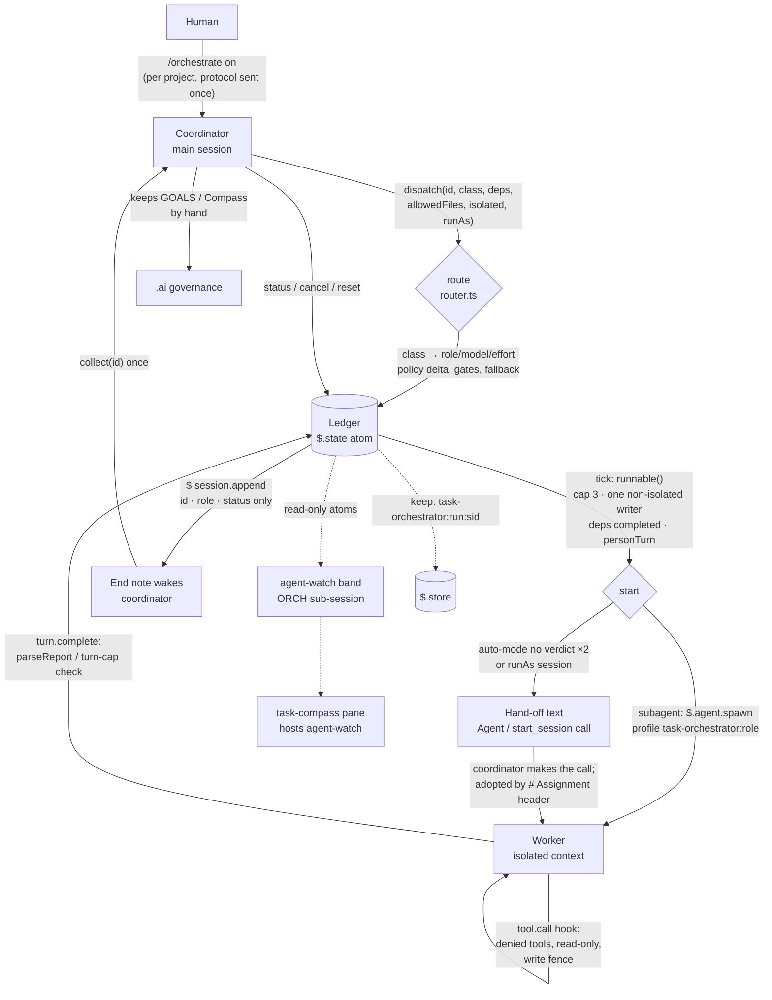
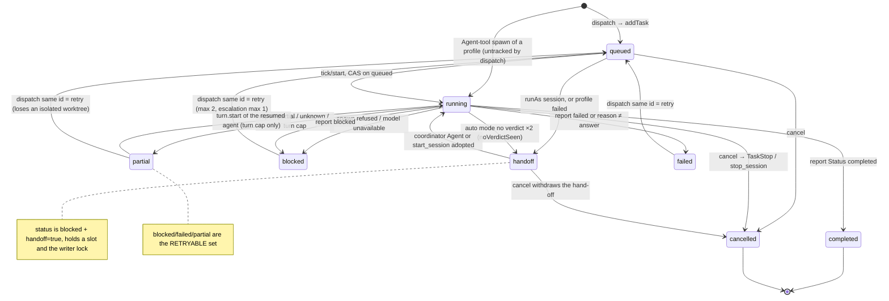
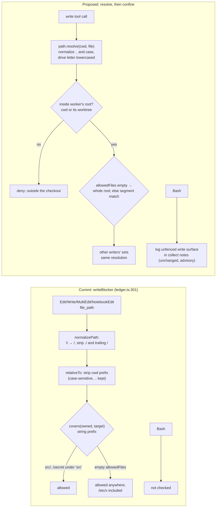
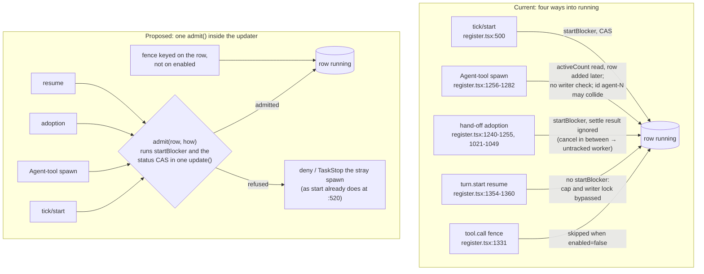
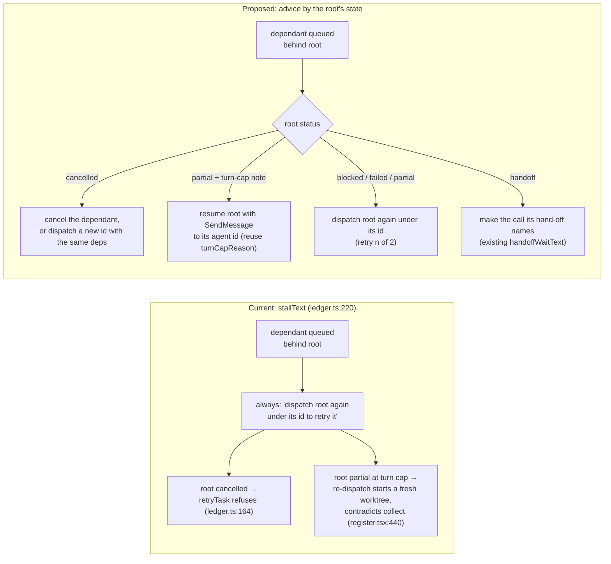
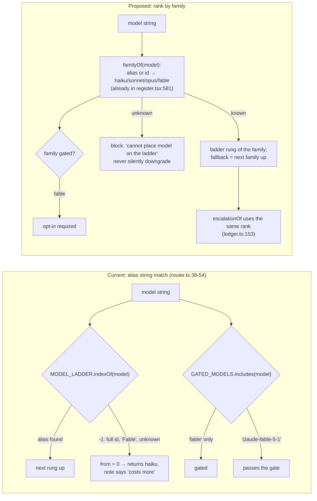
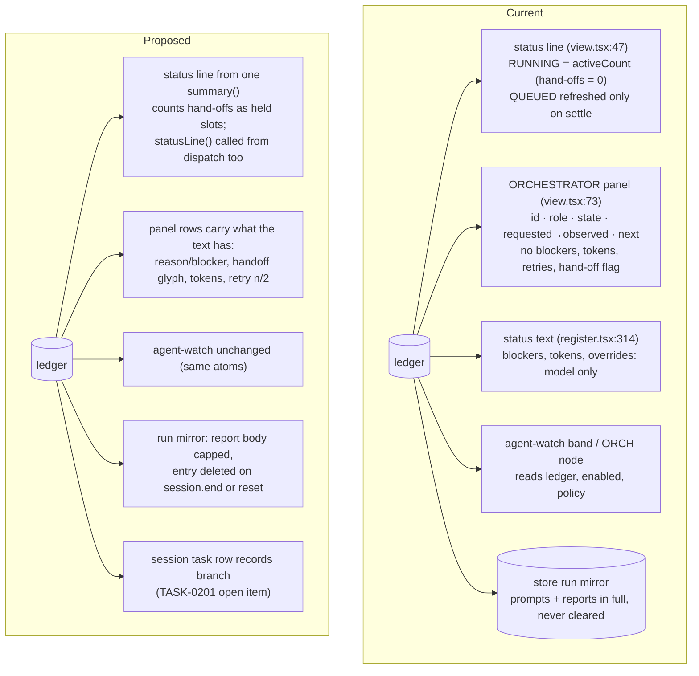

# REVIEW-0013 — The task-orchestrator mod at 0.6.0: completeness, design, and what to change

- Subject: `mods/task-orchestrator/` (the `/orchestrate` mod), master `c752633`, version 0.6.0 after `TASK-0260`.
- Task(s) reviewed: `TASK-0183`, `0191`, `0194`, `0196`, `0200`–`0203`, `0212`, `0214`, `0215`, `0224`–`0226`, `0230`, `0234`, `0236`, `0238`, `0239`, `0260`; `ADR-0041`, `ADR-0050`, `ADR-0054`.
- Reviewer: Claude Fable 5.1 as coordinator, 2026-11-09, with four read-only workers (three `review` at sonnet/high over `register.tsx`+`contract.ts`, the routing layer, and `ledger.ts`+`keep.ts`+`view.tsx`; one `exploration` at sonnet/medium over the briefs, ADRs, backlog and the agent-watch and Compass integration). The coordinator re-read every defect quoted below in the source before keeping it.
- Method: static reading only. No test, gate or live run was executed for this review, so every defect is "read from the code", not "observed". Line numbers are those of `c752633`.
- Verdict: **the mod does most of what it says, and says so unusually honestly; request changes before it leaves experimental.** Fourteen of eighteen enforcement claims hold outright. Four hold only in part. Eleven defects were read from the code, three of which weaken the write fence or the concurrency limits the README names as enforced.

## Scope of this review

Read in full: `README.md`, `ARCHITECTURE.md`, `DEVELOPING.md`, `claude/.claude-plugin/plugin.json`, `claude/hooks/hooks.json`, `claude/status.json`, `claude/hooks/{register.tsx,handle.tsx,contract.ts,routing.ts,router.ts,ledger.ts,keep.ts,view.tsx,overrides.ts,providers.ts,telemetry.ts}`, the six test files, `claude/types/index.d.ts`. The mod has no `core/` and no `preview/` folder (`README.md:16` says `core/` is added only when a second harness needs it). `handle.tsx` is the shared panel-resize handle copied from `mods/_template` (`handle.tsx:12`) and carries no orchestrator logic.

## Findings

### 1. Completeness: what is promised against what the code does

#### 1.1 The tools, the command and the hooks

| Surface | Where | Note |
|---|---|---|
| `dispatch`, `collect`, `status`, `cancel` registered | `register.tsx:1104-1148` | All `isDeferred: false` at registration; the `tool.describe` hook marks them deferred while off (`register.tsx:1314-1318`). |
| Handlers | `answerDispatch` `register.tsx:607-680`; `answerCollect` `:839-940`; `statusText` `:314-333`; `answerCancel` `:983-993` | Every answer is `{ result: string }`, dispatched from the `tool.call` hook (`:1324-1330`). |
| `/orchestrate` subcommands | `register.tsx:1158-1214` | `on`, `off`, `status`, `policy`, `routing`, `models`, `opt-in`, `providers`, `cancel`, `reset`, `theme`, as the README lists. |
| Hooks | `session.start` `:1085-1156`; `command.run` `:1158`; `ui.render` `:1216`; `agent.spawn` `:1220-1285`; `prompt.submit` `:1290-1310`; `tool.describe` `:1314`; `tool.call` `:1324-1350`; `turn.start` `:1354`; `turn.step` `:1363`; `turn.complete` `:1378-1402` | No `prompt.compose` (the security plugin skips it, `ARCHITECTURE.md:62`), no `session.end`. |
| Status line | `view.tsx:47`, called from `register.tsx:206-212` | See 1.4. |
| Toast and end note | `register.tsx:568-569`, `note` `:556-557` | Id, role and status only, as promised. |

#### 1.2 The routing table

The balanced table in `README.md:50-62` matches `DEFAULT_ROUTES` (`routing.ts:50-62`) on all eleven rows. The turn caps in `README.md:68` match `ROLE_PROFILES` (`routing.ts:150-173`). The tool lists match `READ_ONLY_TOOLS`, `WRITER_TOOLS` and `WORKER_DENIED_TOOLS` (`routing.ts:105,111,114`). The policy deltas are `POLICY_DELTAS` (`routing.ts:67-84`), applied by `routesUnder` (`routing.ts:258-265`):

| class → role | RO/W | turns | balanced | economy | quality |
|---|---|---|---|---|---|
| extraction → utility | RO | 10 | haiku/low | same | same |
| lookup → scout | RO | 20 | haiku/low | same | sonnet/low |
| exploration → investigator | RO | 40 | sonnet/medium | haiku/medium | sonnet/high |
| documentation → documentation | W | 30 | haiku/medium | haiku/low | sonnet/medium |
| implementation → builder | W | 120 | sonnet/medium | same | sonnet/high |
| testing → tester | W | 40 | sonnet/medium | same | sonnet/high |
| review → reviewer | RO | 30 | sonnet/high | sonnet/medium | opus/high |
| architecture → planner | RO | 40 | opus/high | sonnet/high | same |
| debugging → debugger | W | 120 | opus/high | sonnet/high | same |
| risk-review → risk-reviewer | RO | 30 | opus/high | same | same |
| frontier → frontier-specialist | W | 80 | fable/high (gated) | same | same |

Divergences: the README has no per-policy table, so `economy` putting the 120-turn debugger on sonnet is only discoverable from `/orchestrate routing` or the code. `ARCHITECTURE.md:10` lists four denied worker tools; the code denies six (`routing.ts:114`, `register.tsx:1335`). The assignment text tells a writer it has "the session's tools under its permission mode, minus agents, workflows and messaging" (`register.tsx:355,634`), while the registered profile limits it to the ten `WRITER_TOOLS` (`register.tsx:238`).

#### 1.3 The eighteen enforcement claims

| # | Claim (README / ARCHITECTURE) | Verdict | Evidence |
|---|---|---|---|
| 1 | A spawn whose parent is a worker is denied | holds, with a dead knob | `register.tsx:1223-1224`. `maxNesting` appears only in the deny text and `limitsText`; setting it to 2 changes nothing. Skipped while off (`:1221`). |
| 2 | Workers may not call Agent, Workflow, SendMessage, TaskStop | holds | `register.tsx:1335` plus profile `disallowedTools` (`:237`). Applies only while `enabled` and the row is `running` (`:1331,1334`). |
| 3 | Write fence on Edit/Write/MultiEdit/NotebookEdit | partly | `register.tsx:1336-1342`, `ledger.ts:301-313`. `..` is not resolved (`normalizePath` `ledger.ts:16-19`; `relativeTo` `:294-298` strips a prefix only), so `src/../secret.txt` passes `covers('src', …)` (`:22`). An empty `allowedFiles` skips the allowed check (`:305`), so such a writer may write absolute paths outside the checkout. Case-sensitive, no drive-letter handling. Bash is unfenced (admitted, `ARCHITECTURE.md:64`). |
| 4 | No-verdict spawn re-issued once, then hand-off | holds | `register.tsx:504-512`; `noVerdictSeen` sticky (`:503,511`). |
| 5 | Adoption of the coordinator's Agent call by the `# Assignment` header, "unchanged" | matching holds; "unchanged" is not checked | Header regex `contract.ts:82-83`, used `register.tsx:1240`. Only the role profile and the start blockers are compared (`:1247-1248`); prompt body, model and isolation are not, unlike the session path's `callMismatch` (`:1002-1011`). |
| 6 | Session hand-off text and adoption from `local_<uuid>` | holds, fragile | Fields `register.tsx:454-459`; `adoptSession` `:1021-1049`; regex `:999` needs `session_id` followed by `:` or a space, so a JSON-quoted `"session_id":"local_…"` does not match. |
| 7 | `sessionGate` refuses above the coordinator's family or effort | holds | `register.tsx:597-605`; effort seeded `:1100` via `settingsEffort` `:587-594`; family compare is a substring match (`:581`). |
| 8 | `personTurn` gate from the prompt's origin | holds | `register.tsx:996,1291`, cleared `:1380-1383`. A prompt with no origin counts as the person's. |
| 9 | `collect` answers at once for subagents, waits ~8 s for sessions, "`collectTimeoutMs` below that" | partly; README wrong | `isPending` `register.tsx:828-837`; wait `:871-886`. The cap is `min(timeoutMs, remainingMs − 1500)` (`:870,:51`) with 10 000 assumed when unmetered (`:53,:843`). `collectTimeoutMs` defaults to 600 000 (`routing.ts:101`), so `README.md:46` is wrong. |
| 10 | End note carries id, role, status only | holds | `register.tsx:556-557,576`. A failed `$.session.append` is swallowed (`:557`), so the coordinator is never woken and nothing is logged. |
| 11 | Reports print once | holds | `register.tsx:100-102,916-917`. In memory only: a restore reprints (`:1090`). |
| 12 | Retry in place, escalation counted | holds, with blind spots | `register.tsx:663-667`, `ledger.ts:161-182`. An unknown model rank never counts as an escalation (`ledger.ts:155`); a re-dispatch of a handed-off task burns a retry (`:135`); the replaced row drops tokens and observed settings (`:179`), so `runTokens` understates a retried run (`:245`). |
| 13 | Cancel via TaskStop / stop_session | holds | `register.tsx:945-965`. |
| 14 | Turn-cap detection and resume | holds against stubs | `cutOffMidStep` `register.tsx:382-387`; `workOf` `:407-431`; `turn.start` `:1354-1360`. The resume path sets `running` without `startBlocker` (see D4). Live unverified (`README.md:106`). |
| 15 | Protocol sent once per session | holds | `register.tsx:95,1294-1304`. `/orchestrate on` re-sends it every time (`:1167`). |
| 16 | Run survives a forced reload | holds, with a gap | `keep.ts:45-72`; restored only into an empty ledger from this session's id (`:65-66`). `lastKept` is set before `store.set` and the write error swallowed (`keep.ts:51-52`), so a failed write is never retried while the JSON is unchanged. Restored `running` rows are never reconciled against live agents. |
| 17 | Config: home file, project narrowing, `__proto__` guard | partly | `loadConfig` `register.tsx:164-192`; `projectOverride` `:143-161`, guard `:150-158`. The home path comes only from `HOME` (`:129,167`), never `USERPROFILE`. A malformed file is swallowed by `readJson` (`:112-119`) and not listed under `config refused`. The project file's `providers` is not narrowed (`:146`). Every `saveSettings` writes the whole trusted config (`:195-198`), so a later edit to the home file's policy is overridden by the store (`:176-178`). |
| 18 | Tokens summed from `turn.complete` usage | holds | `register.tsx:1385-1388`, `ledger.ts:237-242`. Uses a row read before the update (admitted, `ARCHITECTURE.md:56`). |

#### 1.4 Defects read from the code (D1–D11), by severity

| # | Defect | Where | Why it matters |
|---|---|---|---|
| D1 | The write fence does not resolve `..`, and an empty allowed list is not confined to the checkout | `ledger.ts:16-22,294-313` | The README's "writes only inside allowed files" is the mod's main safety claim. A worker given `src` can write `src/../.env`. |
| D2 | `/orchestrate off` lifts the fence and the nesting guard for workers already running | `register.tsx:1221,1331` | The README says `off` "leaves every running worker alone" (`README.md:32`); it also leaves them unfenced. The test at `register.test.tsx:342` notes "the fence lifts" and asserts nothing. |
| D3 | Agent-tool tracking reads the cap, then adds the row; the generated id `agent-N` can collide with a dispatched id, and `addTask`'s refusal is ignored | `register.tsx:1256-1282` | Two parallel Agent calls both pass the cap; a colliding worker runs untracked and unfenced. A writer profile taken this way is stored with empty `allowedFiles` and never checked against `activeWriters`. |
| D4 | Resume (`partial → running`) skips `startBlocker` | `register.tsx:1354-1360` | A resumed worker exceeds the cap and may run beside a second non-isolated writer that started while it was `partial`. |
| D5 | Adoption ignores the settle's result | `register.tsx:1253,1047` | A cancel between the app call and the settle leaves a started worker or session untracked. `start` handles the same race with TaskStop (`:520-521`). |
| D6 | `cancel` with no `id`, or a mistyped key, cancels everything | `register.tsx:1330,983-985` | The schema declares only `id` (`:1146`); the default should refuse, not widen. |
| D7 | `fallback` and `escalate` send any model off the alias ladder to `haiku`, noting "which costs more" | `router.ts:47-54,89-96,112` | A full id such as `claude-sonnet-5-5` that is unavailable is silently downgraded with a note that says the opposite. |
| D8 | The frontier gate matches the literal alias `fable` only | `router.ts:41`, `routing.ts:17` | `claude-fable-5-1` or `Fable` passes without the opt-in (whether the engine accepts the spelling is unverified). |
| D9 | `stallText` always advises "dispatch X again under its id" | `ledger.ts:220`, used by `blockers()` `:258-265` and the dispatch answer `register.tsx:677-679` | Wrong for a cancelled root (`retryTask` refuses, `ledger.ts:164`) and harmful for a turn-capped root, where `collect` says the opposite (`register.tsx:440`): a re-dispatch of an isolated task loses its worktree edits. |
| D10 | The status line's QUEUED count is refreshed only on a settle; RUNNING is `activeCount`, which excludes hand-offs | `register.tsx:206-212`, `ledger.ts:44`; dispatch path `:663-679` never calls `statusLine` | A task queued behind the cap does not change the line; a hand-off that holds a slot shows as 0 RUNNING. |
| D11 | A plain or bold `Status:` line anywhere in the report overwrites the parsed status | `contract.ts:121-128` | A worker echoing tool output can flip its own status. Untested. |

Smaller: the `# Assignment` worker-session detector matches any first prompt that starts so (`register.tsx:1294`); `maxNesting`, `collectTimeoutMs`'s default, `providers` and `telemetry.ts` are dead settings or unwired modules (`telemetry.ts:5-7`; `otlpPayload` is referenced only by its test); `mergeConfig` accepts `maxConcurrent: 0` (`routing.ts:236`); the run mirror holds every prompt and report in full and is never deleted (`ARCHITECTURE.md:52`, `keep.ts:21-32`); the toast promised in `README.md:30` (`… · next step`) no longer carries the next step, by `TASK-0239`'s design (`register.tsx:568`, `register.test.tsx:467`).

#### 1.5 Divergences between the documents and each other

- `README.md:46` says `collectTimeoutMs` is below eight seconds; the default is 600 000 (`routing.ts:101`).
- `README.md:30` promises `T1 · SCOUT · COMPLETED · next step`; the toast is id, role and status (`register.tsx:568`).
- `README.md:80-82` and `ARCHITECTURE.md:50` still list as "not yet seen live" things `TASK-0201:88-90` recorded as seen (two session workers side by side, a hand-off started on the next person's turn, sidebar nesting).
- `ARCHITECTURE.md:10` names four denied tools; the code denies six.
- `TASK-0196` (Compass Subagents panel) is marked done, yet its mirror was removed by `TASK-0207` (`ADR-0048:9`) and the brief carries no superseded note.
- `TASK-0234:5` and `TASK-0238:5` still read "in review" while `TODO.md:278,282` and `GOALS.md:506,514` show them done.
- `TASK-0201` names 0.5.0 in its title and 0.5.10 in its handover (`TASK-0201:77`).
- `ADR-0050` is still "proposed (clause 4 is the human's call)" (`ADR-0050:3`) although `TASK-0201` closed on it. No ADR records the ledger, the hand-off, the per-project settings scope, the store layout or the turn cap; `TASK-0239` and `TASK-0238` decided them in briefs.
- `README.md:20` says 0.5.4 is published; 0.5.5 to 0.6.0 are unpublished (`TASK-0234:69`, `TASK-0236:64`).

#### 1.6 What the tests do not cover

The kit has 66 named tests in `register.test.tsx`, 16 in `ledger.test.ts`, 9 in `router.test.ts`, 8 in `contract.test.ts`, 4 in `overrides.test.ts`, 3 in `telemetry.test.ts`. `view.tsx` and `keep.ts` have no suite of their own (covered at `register.test.tsx:669` light theme only, and `:1571-1631`). Not covered:

- Fence: `..` paths, backslashes and drive case, an absolute path outside `cwd`, an empty `allowedFiles` with an outside path, `MultiEdit`/`NotebookEdit` path extraction (only `Edit` at `:305`), a write with no path, the fence lifted while off, the denied list beyond `Agent` (`:286`).
- Admission: the `agent.spawn` cap denial (`register.tsx:1256`), the resume versus the cap or the writer lock, adoption racing a cancel, the id collision at `:1260`.
- Routing: the full 11×3 policy table (only four cells and the planner under economy at `router.test.ts:67-69`, `register.test.tsx:645`), a model off the ladder, a chain of two unavailable models, gate casing, `escalationOf` for a downgrade or a full id.
- Config: a real home file's content and merge order (`:486` asserts only the path), `USERPROFILE`, malformed JSON, a project `providers` block, `maxConcurrent: 0`.
- Reports: a duplicate `Status:` line, the 200-character `Next` cap, the 1500-character `quotedFindings` cap and its surrogate split (`contract.ts:28-32`).
- `collect`: the ~8 s ceiling itself (`:145,1270` use `timeoutMs: 600_000`), `isPersonTurn` with no origin or `bridge`.
- `keep`: a failed store write, malformed stored data, restore into a non-empty ledger, restored `running` rows whose agents are gone.
- Hidden text: the three fail-closed strings at `register.tsx:1285,1348,1349` appear in no test.
- The gate: `tests/validate.sh` is unchecked in `TASK-0234:57`, `0238:58`, `0239:64`, `0260:60` (WORKTREE suite fails on this Windows host); `tsc` has never been run on the mod (`TASK-0183:84`, `0212:71`).

### 2. The current workflow

Limits shown: three concurrent (`DEFAULT_LIMITS` `routing.ts:97-103`, `startBlocker` `ledger.ts:70`), one non-isolated writer and disjoint files for isolated ones (`ledger.ts:72-82`), two retries and one escalation (`ledger.ts:224-230`), the hand-off holding its slot (`ledger.ts:47,105`).

#### The state of a task

Sources: status values `types/index.d.ts:37`; `ENDED` `ledger.ts:11`; `RETRYABLE` `ledger.ts:135`; `handoff` as a flag `ledger.ts:40`; transitions `register.tsx:487-515` (start), `:1253,1047` (adoption), `:1391-1398` (end), `:1357` (resume), `:963` (cancel), `ledger.ts:161-182` (retry), `:1261-1282` (untracked spawn). `overall` precedence (`ledger.ts:105-126`): failed > blocked > stalled > running > partial > idle > done.

### 3. Pros and cons of the design

**Coordinator protocol** (`contract.ts:144-153`, sent once as command context). Pro: it reaches the model without inflating every tool description, it names the waiting rule, the serial writer rule and the "never commit unasked" rule, and it is the same text a human can read in `ARCHITECTURE.md`. Con: it is advice; nothing enforces "a reviewer separate from the builder" or "integrate serially", and `/orchestrate on` re-sends it on every call (`register.tsx:1167`). The protocol also says nothing about what a coordinator does when a worker's report contradicts its own reading, which this review needed.

**Routing by class** (`routing.ts`, `router.ts`). Pro: the table is data, three policies are deltas over it, the profile per settings keeps two builders at different efforts apart, and the opt-in gates make cost escalation explicit. Con: the class is the coordinator's word; `TASK-0224:25` deferred any check of class against objective, and only the `misclassified?` hint exists (`README.md:64`). The ladder is a list of four alias strings, so full ids fall through (D7, D8). Economy lowers the debugger's model while leaving its 120-turn cap, an expensive combination to get wrong in the quiet direction.

**Report flow, end notes to `collect`** (`register.tsx:556-576,839-940`). Pro: the trust boundary is good: the note carries id, role and status; the worker's words are read only through `collect`, a dependency's findings enter the next assignment as quoted data capped at 1500 characters (`contract.ts:28-32`), and the coordinator is woken by the note rather than polling (seen live 2026-11-05, `ARCHITECTURE.md:53`). Con: a swallowed `append` (`:557`) loses the wake silently; the report parser is label-based and a later `Status:` line wins (D11); the wait inside `collect` catches only sessions, which the docs explain well but which makes `collect`'s eight-second budget mostly a session feature.

**Limits** (`ledger.ts`). Pro: every rule is a pure function over the rows with a test, `queued → running` is a compare-and-set, and `TASK-0239` moved every write inside the atom's updater. Con: the rules are applied on four separate entry paths, only one of which (`start`) applies all of them (D3, D4, D5). The write fence is a prefix match over unresolved strings (D1). `maxNesting` is a configurable constant that does nothing.

**Worker failures and turn caps** (`register.tsx:376-442,1354-1402`). Pro: the cap is detected from the transcript rather than from the engine's reason, the worktree and branch are named, and the advice to resume rather than re-dispatch is right. Con: the detection is a heuristic on the last transcript row (`:382-387`) that has run only against stubs; the resume path reopens the row without the limits (D4); the stall advice for dependants contradicts it (D9); the reserve is text the worker may ignore (`ARCHITECTURE.md:66`).

**Integration with task-compass and `.ai/` governance.** Pro: the boundary is clean and one-directional: agent-watch reads three atoms (`ledger`, `enabled`, `policy`; `mods/agent-watch/claude/hooks/band.tsx:18-22`) and draws the band, the `ORCH` sub-session and the `TASKS` bar (`sessions.ts:292-346`); Compass hosts agent-watch's contribution and holds no copy (`mods/task-compass/DEVELOPING.md:56`, `ADR-0048`); workers are told to leave the board alone (`contract.ts:57`). Con: the orchestrator writes nothing to the governance layer. The board, the brief and the session log stay the coordinator's manual work, and the audit rows in the store (`register.tsx:201-203`) are not surfaced anywhere a human reads. A session task records no branch (`TASK-0201:79`), so a run that produced branches leaves no trace of them in the ledger.

**Observability for the human.** Pro: `status` prints requested beside observed model and effort, the overrides in force and the refused config; the panels and the band use the same state vocabulary (`view.tsx:32-42`, `sessions.ts:208`). Con: the panel drops what the text has (blockers, retry count, tokens, a hand-off glyph: `register.tsx:303`, `view.tsx:8,73-103`), so a human reading the panel loses the retry guidance; the status line is stale after a dispatch that queues (D10); the run mirror in the store is an unbounded, never-cleared copy of every prompt and report (`ARCHITECTURE.md:52`).

**Portability.** Pro: `routing.ts`, `router.ts`, `ledger.ts` and `contract.ts` are pure and import no engine API, as `README.md:16` and `ADR-0054:19` say, and the tests prove it. Con: `register.tsx` is 1 403 lines and holds the config loader, the hand-off text, the session adoption, the turn-cap detector and the status text beside the hooks; nothing but the four pure modules could move to a `core/` today, and the hand-off and adoption logic (the part a second harness would most need to redo) is woven into the hooks.

### 4. Recommendations, ranked

Each pairs the current flow with the proposed one. The first three close defects in enforced rules; the last two are observability and governance. None changes the routing table or the tool API.

#### R1. Resolve paths before fencing (D1)

Change `normalizePath`/`relativeTo`/`writeBlocker` (`ledger.ts:16-22,294-313`): resolve the path against the worker's root (its `cwd`, or its worktree for an isolated task), normalize `..` and case and the drive letter, deny anything that resolves outside that root, treat an empty `allowedFiles` as "the whole root" rather than "anywhere", and match segments rather than string prefixes. Add the missing tests in `ledger.test.ts`. Bash stays unfenced; say so in the task's `collect` notes rather than only in `ARCHITECTURE.md`.

Pro: closes the one gap in the mod's central safety claim with a local change and no API change. Con: whether `$.session.cwd()` inside an isolated worker's hook is the worktree or the parent is unverified (`register.tsx:1340`); the change needs a live check in a worktree before the fence can be trusted there.

#### R2. One admission gate for every way into `running` (D2, D3, D4, D5)

Add an `admit(rows, task, how)` in `ledger.ts` that runs `startBlocker` and the status compare-and-set in one `update()` call, and route `start` (`register.tsx:500`), the Agent-tool path (`:1256-1282`), both adoptions (`:1253,1047`) and the resume (`:1357`) through it. When admission fails after the app call already ran, stop the stray worker as `start` already does (`:520-521`). Generate the untracked-spawn id from a counter that cannot collide, and refuse rather than ignore an `addTask` failure. Key the fence on the row's existence, not on `enabled` (`:1331`), so `/orchestrate off` keeps running workers fenced, as the README implies.

Pro: the limits become true in every path, not just the common one, and the three races collapse into one tested function. Con: a resume refused by the cap has to wait; the resumed agent's turn is already running when `turn.start` fires, so "refuse" there means "stop it and tell the coordinator to resume later", a new message to design. Also fix D6 here: `cancel` with no id refuses.

#### R3. Stall advice that follows the root's state (D9)

Make `stallText` (`ledger.ts:220`) branch on the root: cancelled → cancel the dependant or dispatch a new id; `partial` with the turn-cap note → resume the root with `SendMessage` (reuse `turnCapReason`, `register.tsx:434-442`); otherwise the present retry text; hand-off keeps `handoffWaitText`. `blockers()` (`:258-265`) and the dispatch answer (`register.tsx:677-679`) then say the same as `collect`.

Pro: small, pure, testable; removes the one place where following the mod's advice destroys work. Con: `turnCapReason` is in `register.tsx` and needs git; the pure `stallText` can only name the action, and `blockers()` would have to take the reason text in.

#### R4. Rank models by family, not by alias string (D7, D8)

Use the existing `familyOf` (`register.tsx:581`) in `router.ts`: map alias or id to a family, rank by the family's rung, gate by family, and block a model that cannot be placed instead of falling to `haiku`. Have `escalationOf` (`ledger.ts:153-159`) use the same rank. Move `familyOf` into `routing.ts` so both pure modules share it.

Pro: one rank for routing, escalation counting and the gate; the person's "assign to sonnet 5.5" path (`README.md:86`) then falls back and counts correctly. Con: a family match by substring can misplace a future id; keep the unknown case a block, never a guess.

#### R5. Let the human see what the model sees, and bound the mirror (D10 and the panel gap)

Build the status line from one `summary()` that counts hand-offs as held slots and call `statusLine` from the dispatch path too (`register.tsx:663-679`). Give `TaskView` (`view.tsx:8`) the reason or blocker, a hand-off glyph, retry `n/2` and tokens, so the panel is not poorer than the text (`register.tsx:303`). Cap the report body kept in the run mirror and delete the entry on `/orchestrate reset` and at session end (`keep.ts:21-32`). Record the branch on a session task's row (`TASK-0201:79`).

Pro: no new state and no change to agent-watch's contract; the human stops needing the raw text to know why a task waits. Con: the panel has a width budget on the desktop (`TASK-0257` hit the 100 000-character draw limit in switchboard), so each added column needs the `fit` treatment the other mods use.

#### Lesser fixes, no diagram

- D11: in `parseReport`, let the first strong `Status:` win, or only the last line block (`contract.ts:121-128`).
- Config: read `USERPROFILE` when `HOME` is unset; list a malformed file under `config refused`; narrow `providers` from the project file; stop `saveSettings` from pinning the home file's values (`register.tsx:112-198`).
- Dead knobs: remove `maxNesting` from `Limits` or enforce it; correct `README.md:46` on `collectTimeoutMs`; either wire `telemetry.ts` or move it out of the shipped hooks.
- Docs: fix `README.md:30,46,80-82`, `ARCHITECTURE.md:10,50`; mark `TASK-0196` superseded by `TASK-0207`; set `TASK-0234` and `TASK-0238` to done or reopen them; accept or withdraw `ADR-0050`; write the missing ADR for the ledger, the hand-off, the per-project settings scope and the store layout, which `TASK-0238` and `TASK-0239` decided in briefs.
- Tests: add the 11×3 routing table test, the fence cases in 1.6, and run `tsc` once on the mod.
- `core/`: not yet. The four pure modules already import no engine API; a `core/` without a second harness is a move with no consumer (`ADR-0054:19`). What would make the move cheap later is pulling the hand-off text and the adoption matching out of `register.tsx` into a pure module now, since those are what Codex or OpenCode would need to redo.

## Validation results

- No command, test or gate was run for this review; every finding is static reading, with the coordinator re-reading each kept defect in the source (`router.ts:38-54`, `register.tsx:983-993,1219-1286,1324-1350,1352-1361`, `ledger.ts:14-26,216-222,292-313`, `view.tsx:45-50`).
- The Mermaid in this file was validated with the session's Mermaid tool: all seven diagrams render.
- Nothing in the mod was changed and no version was bumped.

## Verdict

The mod's documents are the best part of it: `ARCHITECTURE.md` separates enforced from observed from advisory, and most of what this review found was already half-admitted there (`..`, Bash, the fence lifted when off, the alias-only gate, the dead settings are all in `TASK-0239:32`'s out-of-scope list). What was not admitted is that the admission rules hold on one of four entry paths, that the stall advice can destroy a turn-capped worker's edits, and that the fence's "allowed files" is a prefix over unresolved strings. R1 and R2 are the price of calling the limits "enforced in code"; R3 is small and prevents data loss; R4 and R5 can wait a version. Until R1 and R2 land, run writers isolated and give every one an explicit `allowedFiles`, which is what the protocol already recommends.

## Follow-up tasks

- `TASK-0265` (opened 2026-11-10 from this review) applies R1 to R5, D11 and the lesser fixes, with tests, and steps the mod to 0.7.0; `ADR-0058` records the ledger, hand-off, settings-scope and store decisions the briefs had taken.
- Live checks, owed after `TASK-0265`: a worker in a real worktree writing through the resolved fence (what `$.session.cwd()` returns inside a worker's hook); a resume refused by the cap; a branch read from a real `start_session` answer.
- The human's: accept or withdraw `ADR-0050`; publish the next version to the organization library (the library still holds 0.5.4).
- Not taken: fencing Bash writes (no path to check), a `core/` folder before a second harness (`ADR-0054` clause 4), wiring telemetry to an exporter (the unwired module is removed instead).
