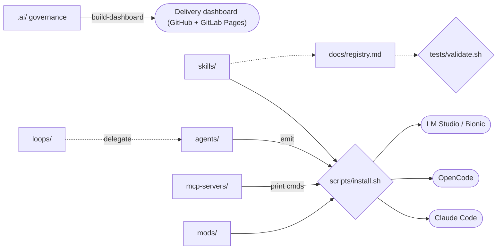
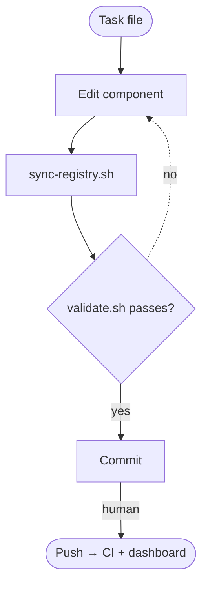

# ai-toolbox: what it provides and how it works

Read-only review, 2026-11-04. Repo `armando.martires/ai-toolbox`, branch `master`, commit `27fcff8` (GitHub mirror: armandomartires/ai-toolbox). Companion: [standards and remediation report](2026-11-04-standards-remediation.md).

## Overview
A monorepo that collects, develops, validates and deploys AI customization tools to Claude Code, OpenCode and LM Studio (Bionic). Components are self-contained; `.ai/` records the why (tasks, ADRs, plans, reviews).

| Skills | MCP servers | Loops / roles | Mods | Tasks | ADRs |
|---|---|---|---|---|---|
| 8 (+template) | gates (authored), ansible, graphify (external) + 2 templates | 5 / 15 (+templates) | 4 (+template) | 224 | 53 |

## Architecture


## Skills
| Skill | Purpose | How it works | Depends on |
|---|---|---|---|
| project-workflow | Maintain a project's `.ai/` planning layer | Schema-driven generators; HTML burn-up dashboard; files/GitLab/GitHub trackers | Python 3.11, Bash, Pages CI |
| project-migration | Retrofit a repo with the governance framework | Scaffolds AGENTS.md, CLAUDE.md, `.ai/` | project-workflow schemas |
| unattended-ops | Method behind unattended-run | Five rules, five verdicts, evidence rule, gate map, client bindings | gates MCP, git |
| design-flow | Method behind design-brief | Clarify, distinct options, adversarial critique | ideator, critic |
| ansible-ops | Safe Ansible changes | Obligation set, nine gates, change record | ansible MCP, Vault |
| vault-secrets | Secrets into one child process | `secrets.map` → Vault KV v2; `exec VAR -- cmd` | Vault, AppRole |
| repo-inventory | Find unpushed work across clones | Offline, read-only scan | git, Python |
| mod-dev | Agent stages of the mod workflow | Shape check, scaffold, validate, sync, preview, test | mods kit |

## MCP servers
| Server | Shape | What it does |
|---|---|---|
| gates | Python FastMCP | `list_gates`, `start_gate`, `wait_gate`, `gate_status`, `kill_gate`: run named gates from the consuming repo's map behind a watchdog. `start_gate` is destructive. |
| ansible | external | `@ansible/ansible-mcp-server@26.6.0` |
| graphify | external | `@sentropic/graphify@0.18.0`, read-only graph queries |

## Loops and roles
| Loop | Purpose | Roles |
|---|---|---|
| design-brief | Ideate–critique until a brief is locked | designer-manager, ideator, critic |
| project-build | Plan → implement → test → review → commit; no push | qa-test, review, git-ops |
| unattended-run | Overnight queue with evidence; parks unprovable work | preflight, run-scribe, task-planner, implementer, gate-runner, refuter, adjudicator, park-steward, closer |
| release-check | Verify, index, review, commit | — |
| ansible-change | Nine gates and change record | — |

## Mods (Claude Code plugins)
| Mod | Adds |
|---|---|
| task-orchestrator 0.5.x | Lead-coordinator mode, worker profiles, isolated subagents, limits; `/orchestrate` |
| agent-watch | Agents pane, sessions sunburst, failure toasts, progress meter |
| task-compass | Sprint board pane from `.ai/` |
| switchboard | Per-project on/off for mods, skills, MCP |

## Scripts, tests, CI
- `scripts/install.sh` link/copy, `--only`, `--status`; `scripts/sync-*.sh`; `preview-mods.py`, `dev-mods.py`.
- `tests/validate.sh` mandatory offline gate, also in `.githooks/pre-commit`; `smoke-mcp.sh`, `test-mods.sh` outside it.
- CI: GitHub validate, dashboard, dashboard-daily, ci-alert; GitLab: dashboard Pages only.

## Key flows

```mermaid
sequenceDiagram
  preflight->>task-planner: proceed
  task-planner->>implementer: file-level plan
  implementer->>gate-runner: files changed
  gate-runner->>refuter: gate evidence
  refuter->>adjudicator: findings
  adjudicator->>closer: accept / retry / park / raise-adhoc / halt
  Note over closer: accept → commit; park → stash; never push
```

## Setup
1. Bash, `python3` ≥ 3.11, `uv`, Node for mod tests.
2. Optional `.env` from `.env.example`; secrets via `vault_secrets.py exec`.
3. `bash scripts/install.sh link` · 4. `bash tests/validate.sh` · 5. `uv --directory mcp-servers/gates run gates`.

## Gaps and risks
- Mod features marked tested in kit but not seen live.
- CI validate runs on GitHub only.
- `start_gate` runs what the consuming repo's map declares.
- WSL `/mnt/c` file-mode breakage history; heavy governance overhead; `configs/` is READMEs only.
