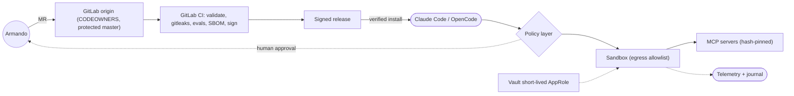

# ai-toolbox: alignment with AI engineering standards

Evidence: `master` at `27fcff8` (2026-11-04), read-only. Companion: [review](2026-11-04-ai-toolbox-review.md). Scale: 1 absent · 2 weak · 3 partial · 4 good · 5 exemplary.

**Bottom line:** process discipline (human gates, evidence, secrets) is strong; gaps are runtime isolation, supply-chain provenance, prompt-injection defences and agent evals.

## Scorecard
| Area | Standard | Aligns | Gaps | Rating |
|---|---|---|---|---|
| Human-in-the-loop | OWASP LLM06; NIST AI RMF Manage | Loops stop before push; AGENTS.md bars unauthorised destructive tools; refuter/adjudicator | Approvals are prose, not enforced | 5 |
| Secrets | OWASP LLM02 | `skills/vault-secrets`, `secrets.map`, `.env*` ignored | No secret scanner | 4 |
| Docs & decisions | ISO/IEC 42001 | 53 ADRs, 224 tasks, registry, runbook | No threat model / risk register | 4 |
| Versioning & release | SemVer, plugin manifests | `plugin.json` versions, CHANGELOG | No tags; org-library publish without scan | 3 |
| Claude Code practice | Anthropic skills/hooks/plugins | SKILL.md frontmatter, hooks.json, install.selection | Hooks run with full rights; features not seen live | 3 |
| CI & testing | NIST SSDF | validate.sh, pre-commit, ci-alert.yml | Validate on GitHub only | 3 |
| Observability | OWASP Agentic traceability | run-scribe journal, agent-watch | No OTel, no tamper-evident log | 3 |
| MCP security | MCP spec; OWASP MCP cheat sheet | gates takes name only (`mcp-servers/gates/src/gates/server.py`) | Map commands unrestricted; no tool hashing; `npx -y` unsandboxed | 2 |
| AI risk governance | NIST AI RMF, AI 600-1, 42001 | Implicit via ADRs | No risk register / Measure | 2 |
| Supply chain | SLSA, SBOM, Sigstore | npm versions pinned; `uv.lock` | Actions on tags; no SBOM/provenance/signing; no Renovate | 2 |
| Prompt injection | OWASP LLM01; Agentic | Adversarial review | No untrusted-content policy; no CODEOWNERS; no Unicode scan | 2 |
| Sandboxing | OWASP DevSecOps AI agent | One-writer preflight, worktrees | Runs on dev host with user creds, open egress | 2 |
| Agent & prompt evals | NIST AI 600-1 Measure | Unit/contract tests | No eval suite | 1 |

## Remediation plan
### Quick wins
| # | Item | Effort | Impact | Steps |
|---|---|---|---|---|
| Q1 | Run validate in GitLab CI | S | High | Add `validate` job (python:3.11) to `.gitlab-ci.yml`; require for merge |
| Q2 | Pin Actions by SHA | S | Med | Replace `@v4/@v5/@v3` with SHAs; Dependabot for actions |
| Q3 | Secret scanning | S | High | gitleaks in pre-commit and both CIs |
| Q4 | CODEOWNERS for instruction files | S | Med | Protect AGENTS.md, CLAUDE.md, agents/, loops/, SKILL.md; hidden-Unicode check |
| Q5 | Label unverified features | S | Med | `status: experimental` in READMEs/registry; off by default |
### 30 days
| # | Item | Effort | Impact | Steps |
|---|---|---|---|---|
| D1 | Constrain `gates` commands | M | High | Hash-pinned, CODEOWNED gate map; executable allowlist; run in container/bwrap, no network; authorisation token |
| D2 | MCP pinning and sandbox | M | High | Lockfile installs with integrity; hash tool definitions, fail on change; containers with egress allowlist |
| D3 | Prompt-injection policy | M | High | `docs/security/untrusted-content.md`; rule in every role; schema-validate outputs; injection fixtures |
| D4 | Live verification of mods | M | Med | release-check requires a recorded live session before leaving experimental |
### 90 days
| # | Item | Effort | Impact | Steps |
|---|---|---|---|---|
| N1 | Agent eval suite | L | High | `evals/` golden tasks; verdict accuracy, refuter recall, injection resistance; nightly per model |
| N2 | Sandboxed unattended runs | L | High | Disposable container/VM, no home mount, short-lived AppRole, egress allowlist |
| N3 | Supply-chain provenance | M | Med | CycloneDX SBOMs, SLSA provenance, Sigstore signing, Renovate |
| N4 | AI risk register | M | Med | Map to NIST AI RMF / AI 600-1; `.ai/context/risk-register.md` |
| N5 | Structured telemetry | M | Med | OTel GenAI spans; append-only hashed journal |

## Improvements beyond fixes
1. Policy engine (e.g. OPA) between agents and tools. 2. Per-component threat models. 3. Benchmarks feeding worker profiles. 4. Skill manifests with checksums. 5. Eval scores and CI parity on the dashboard.

## Target state

## Sources
- OWASP Top 10 for LLM Applications 2025 — https://genai.owasp.org/llm-top-10/
- OWASP Agentic AI Threats and Mitigations — https://genai.owasp.org/resource/agentic-ai-threats-and-mitigations/
- OWASP MCP Security Cheat Sheet — https://cheatsheetseries.owasp.org/cheatsheets/MCP_Security_Cheat_Sheet.html
- OWASP AI Agent Security Cheat Sheet — https://cheatsheetseries.owasp.org/cheatsheets/AI_Agent_Security_Cheat_Sheet.html
- OWASP DevSecOps AI Agent and MCP Security — https://owasp.github.io/DevSecOpsGuideline/2-Process/2-2-Develop/2-2-5-AI-Agent-and-MCP-Security/
- MCP Security Best Practices — https://modelcontextprotocol.io/specification/draft/basic/security_best_practices
- NIST AI RMF — https://www.nist.gov/itl/ai-risk-management-framework
- NIST AI 600-1 — https://nvlpubs.nist.gov/nistpubs/ai/NIST.AI.600-1.pdf
- Claude Code hooks — https://docs.anthropic.com/en/docs/claude-code/hooks ; plugins — https://docs.anthropic.com/en/docs/claude-code/plugins
- SLSA v1.0 — https://slsa.dev/spec/v1.0/ ; Sigstore — https://www.sigstore.dev/ ; ISO/IEC 42001 — https://www.iso.org/standard/81230.html
