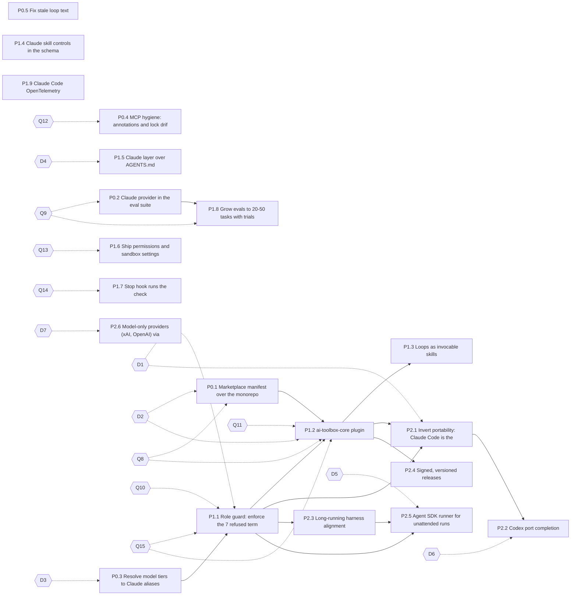

# ai-toolbox alignment plan

> Claude-centric toolbox with ports to other harnesses: decision questionnaire and full plan.

| | |
|---|---|
| Repository | armandomartires/ai-toolbox (GitLab armando.martires/ai-toolbox, mirrored to GitHub) |
| Commit | `a4704ca` (`a4704caacf609cf22ecdb41193855580a9d7da3b`, origin/master, 2026-11-10 07:23 CET) |
| Date | 2026-11-10 (Europe/Brussels) |
| Alignment score | **54.5 / 100** (weighted mean 2.18 / 4; shown as 54/100 in the HTML) |
| Source assessment | "ai-toolbox alignment" (`index.html` in this folder); data in `alignment.json` |
| Companion report | "ai-toolbox overview" (`../ai-toolbox-report/index.html`) |
| Machine-readable answers | `decisions.yaml` (same question and option ids) |

## Contents

- [Rubric](#rubric)
- [How to use this file](#how-to-use-this-file)
- [Decision questionnaire](#decision-questionnaire)
- [Full alignment plan](#full-alignment-plan)
- [Order of execution](#order-of-execution)
- [Summary table](#summary-table)
- [Sources](#sources)
- [Assumptions and unverified points](#assumptions-and-unverified-points)

## Rubric

Scale: 0 absent, 1 ad hoc, 2 partial, 3 mostly aligned, 4 optimal. Points = weight x score / 4. Dimensions are numbered Dim-1..Dim-10 here so they do not clash with decision ids D1-D7.

| Dim | Dimension | Weight | Score | Points | Gap |
|---|---|---:|---:|---:|---|
| Dim-1 | Distribution and packaging | 15 | 1 / 4 | 3.8 | No marketplace; core components are machine-local links, not installable, versioned plugins. |
| Dim-2 | Instructions and memory layering | 8 | 3 / 4 | 6.0 | Good cross-vendor base; no Claude-only layer and no path-scoped rules. |
| Dim-3 | Skills | 12 | 3 / 4 | 9.0 | Strong on the open standard; unused Claude Code skill controls; loops not exposed as commands; no skill-trigger evals. |
| Dim-4 | Subagents and orchestration | 12 | 1 / 4 | 3.0 | The primary harness gets 27% of the roles; design-brief, project-build and unattended-run cannot run as authored under Claude Code. |
| Dim-5 | Hooks and deterministic enforcement | 10 | 2 / 4 | 5.0 | Enforcement lives in git hooks and prose, not in the harness. |
| Dim-6 | Permissions, sandboxing and security | 12 | 3 / 4 | 9.0 | Repo-side controls are good; harness-side controls (permissions, sandbox) and signing are missing. |
| Dim-7 | MCP servers | 8 | 2 / 4 | 4.0 | Missing annotations, lock drift, manual wiring. |
| Dim-8 | Evals and verification | 10 | 2 / 4 | 5.0 | No Claude provider while Claude is the target; small suite; single trial; no skill or loop evals. |
| Dim-9 | Observability and long-running harness | 6 | 3 / 4 | 4.5 | Run history is good; harness telemetry is missing. |
| Dim-10 | Portability (ports layer) | 7 | 3 / 4 | 5.2 | Ports are principled but the centre of gravity is OpenCode, the opposite of the goal. |
| | **Total** | **100** | **2.18 / 4** | **54.5** | |

Top 5 moves:

1. **Role guard so all 15 roles run in Claude Code** (P1.1 (N1)): Biggest single gap (Dim-4 score 1): PreToolUse hooks keyed on agent_type plus permission rules replace the seven refusals.
2. **Ship as a Claude Code marketplace and core plugin** (P0.1 (Q1), P1.2 (N2)): One /plugin install gives skills, agents, hooks, gates MCP and mods, versioned and validated.
3. **Evaluate on Claude, with a real suite** (P0.2 (Q2), P1.8 (N8)): Add the anthropic provider, grow to 20-50 tasks with trials and transcripts.
4. **Loops as /commands, skills with Claude controls** (P1.3 (N3), P1.4 (N4)): Procedures one command away; side-effect skills user-invoked only.
5. **Claude-first single source with generated ports** (P2.1 (S1)): Invert ADR-0018 so OpenCode and Codex become generated ports of a Claude reference profile.

## How to use this file

1. **Answer the questionnaire first.** For each question tick exactly one box (`- [x]`) for *single-select*, or every box that applies for *multi-select*. Use the `Other / notes:` line for anything else; an answer of Other must say what to do instead.
2. **Mirror the answers in `decisions.yaml`** (set `answer:` to the option key, or a list for multi-select, and `notes:`), so an agent can parse them. If the two disagree, this file wins and the YAML must be corrected.
3. **Blocked items wait.** A plan item marked `Blocked by Dn` (or `Qn`) must not start until that question is answered, and must follow the chosen option. Items with no `Blocked by` line can start once their item dependencies are done.
4. **Recommended** marks the option the assessment favours; it is not an answer. Nothing is decided until a box is ticked.
5. **IDs.** Plan items use phase ids `P0.x` (quick wins), `P1.x` (near term), `P2.x` (strategic); the assessment's original ids (`Q1`, `N1`, `S1` ...) follow in brackets. Decision ids `D1`-`D7` come from the assessment; `Q8`-`Q15` are sub-decisions this plan implies.
6. **Prior work.** Remediation items from the 2026-11-04 standards report are always written as "remediation item X" or by issue number (#10, #11, #12, #14) or risk id (R-05, R-10), so they are not confused with these ids.

Which question unblocks which items:

| Question | Topic | Select | Recommended | Unblocks |
|---|---|---|---|---|
| [D1](#d1) | Per-role command boundaries in Claude Code (ADR-0018 clause 8.3) | single | B | [P1.1 (N1)](#item-P1-1), [P2.1 (S1)](#item-P2-1) |
| [D2](#d2) | Claude Code marketplace as the primary distribution | single | B | [P0.1 (Q1)](#item-P0-1), [P1.2 (N2)](#item-P1-2) |
| [D3](#d3) | Model tier per role | single | B | [P0.3 (Q3)](#item-P0-3) |
| [D4](#d4) | CLAUDE.md layer over AGENTS.md (ADR-0002) | single | B | [P1.5 (N5)](#item-P1-5) |
| [D5](#d5) | Runner for unattended runs | single | D | [P2.5 (S5)](#item-P2-5) |
| [D6](#d6) | Port tiers | multi | A, B, C | [P2.2 (S2)](#item-P2-2) |
| [D7](#d7) | Remote MCP endpoint for gates | single | A | [P2.6 (S6)](#item-P2-6) |
| [Q8](#q8) | Marketplace hosting and source type | single | D | [P0.1 (Q1)](#item-P0-1), [P1.2 (N2)](#item-P1-2) |
| [Q9](#q9) | Eval budget and trials | single | B | [P0.2 (Q2)](#item-P0-2), [P1.8 (N8)](#item-P1-8) |
| [Q10](#q10) | Role-guard rollout mode | single | A | [P1.1 (N1)](#item-P1-1) |
| [Q11](#q11) | Plugin granularity | single | A | [P1.2 (N2)](#item-P1-2) |
| [Q12](#q12) | graphify MCP server | single | B | [P0.4 (Q4)](#item-P0-4) |
| [Q13](#q13) | Scope of shipped permissions and sandbox | single | C | [P1.6 (N6)](#item-P1-6) |
| [Q14](#q14) | Stop-hook check scope | single | B | [P1.7 (N7)](#item-P1-7) |
| [Q15](#q15) | Rollout order after the quick wins | single | B | [P1.1 (N1)](#item-P1-1), [P1.2 (N2)](#item-P1-2) |

## Decision questionnaire

### D1. Per-role command boundaries in Claude Code (ADR-0018 clause 8.3)

**Context.** emit-agents.py refuses 7 capability terms for Claude Code (test-files-only, bash-allowlist, test-allowlist, no-force-push, no-bypass, push-requires-confirmation, webfetch-requires-confirmation), so only 4 of 15 roles are emitted there (scripts/emit-agents.py VOCAB; .ai/decisions/ADR-0018-agent-portability-one-source-per-client-emission.md). Current Claude Code docs run settings and plugin hooks inside subagents with agent_type in the input, support PreToolUse deny / ask and onFailure: block, and per-tool permission rules; but hook if-matching is documented as best-effort, and plugin subagents ignore hooks and permissionMode. Sources: [A4](#src-a4), [A5](#src-a5), [A12](#src-a12), [A2](#src-a2).

**Question.** How should the seven refused terms be handled for Claude Code?

*Single-select.* Recommended: **B**.

- [ ] **A.** Keep ADR-0018 as is; Claude Code stays at 4 roles - No risk, but design-brief, project-build and unattended-run stay OpenCode-only.
- [x] **B.** Measure first (fixture per term, like TASK-0107), then supersede 8.3 with a new ADR only for terms that pass **(Recommended)** - Small delay; every enforced boundary is proven before it ships.
- [ ] **C.** Supersede 8.3 now and enforce all seven with the role guard plus permission rules - Fastest, but ships unmeasured security boundaries.
- [ ] **D.** Enforce only the push / force-push terms via permission rules; keep the rest refused - Covers the highest-impact rules; roles needing bash-allowlist stay OpenCode-only.

Other / notes: ______________________________

Unblocks: [P1.1 (N1)](#item-P1-1), [P2.1 (S1)](#item-P2-1)

### D2. Claude Code marketplace as the primary distribution

**Context.** install.sh symlinks skills, emits agents into ~/.claude/agents (scripts/install.sh:589) and exposes mods through CLAUDE_CODE_PLUGIN_DIRS (scripts/install.sh:53); mods are also published to the claude.ai org library. There is no .claude-plugin/marketplace.json, and skills and agents are not a plugin. Sources: [A6](#src-a6), [A7](#src-a7), [A8](#src-a8), [A26](#src-a26).

**Question.** What should be the primary way to install ai-toolbox for Claude Code?

*Single-select.* Recommended: **B**.

- [ ] **A.** Keep install.sh as primary; add the marketplace only as an optional extra - Least change; users still need a clone and a shell script.
- [x] **B.** Marketplace + plugins primary; install.sh kept for development and non-Claude ports **(Recommended)** - Standard /plugin install flow, versioned; two paths to keep in sync.
- [ ] **C.** Marketplace only; retire install.sh for Claude Code entirely - Simplest for users; dev link mode and the current tests need rework.

Other / notes: ______________________________

Unblocks: [P0.1 (Q1)](#item-P0-1), [P1.2 (N2)](#item-P1-2)

### D3. Model tier per role

**Context.** Agents emit model as an unresolved {tier:<name>} placeholder; the tier table lives only in the external opencode-customization doc, so it resolves nowhere (scripts/emit-agents.py docstring). ADR-0017 says ai-toolbox owns agent tiers. Claude Code accepts sonnet, opus, haiku, a full model id or inherit. Sources: [A4](#src-a4).

**Question.** Which tiering policy should the emitter apply?

*Single-select.* Recommended: **B**.

- [ ] **A.** inherit for every role - Zero cost decisions now; every role runs on the session model.
- [x] **B.** Per-role tiers from the table below, default inherit **(Recommended)** - Better cost / quality fit; one table to maintain in .ai/context.
- [ ] **C.** opus for every role - Highest quality and cost; unattended runs get expensive.
- [ ] **D.** Per-role tiers, but unattended roles capped at sonnet - Bounded cost for long runs; judgement roles may be weaker there.

Per-role tier (only if B or D is chosen; the suggestion is the assessment's starting point, edit freely):

| Role | Suggested | Your tier (opus / sonnet / haiku / inherit) |
|---|---|---|
| adjudicator | opus | opus |
| closer | haiku | haiku |
| critic | opus | opus |
| designer-manager | opus | opus |
| gate-runner | haiku | haiku |
| git-ops | sonnet | sonnet |
| ideator | sonnet | sonnet |
| implementer | sonnet | sonnet |
| park-steward | haiku | haiku |
| preflight | haiku | haiku |
| qa-test | sonnet | sonnet |
| refuter | opus | opus |
| review | sonnet | sonnet |
| run-scribe | haiku | haiku |
| task-planner | opus | opus |

Other / notes: ______________________________

Unblocks: [P0.3 (Q3)](#item-P0-3)

### D4. CLAUDE.md layer over AGENTS.md (ADR-0002)

**Context.** CLAUDE.md is a git symlink to AGENTS.md (ADR-0002), and .claude/ is gitignored (.gitignore:33), so there are no tracked Claude-only notes or path-scoped rules. Claude Code supports @AGENTS.md imports and .claude/rules/*.md with a paths filter. Sources: [A11](#src-a11), [A2](#src-a2), [S5](#src-s5).

**Question.** How should Claude-specific instructions be layered?

*Single-select.* Recommended: **B**.

- [ ] **A.** Keep the symlink - No change; no Claude-only layer, no path-scoped rules.
- [x] **B.** Short CLAUDE.md that imports @AGENTS.md plus Claude-only notes, and track .claude/rules/ **(Recommended)** - Recommended layering; supersedes ADR-0002, needs a .gitignore exception.
- [ ] **C.** Keep the symlink, but track .claude/rules/ only - Path-scoped rules without touching ADR-0002; no Claude-only top-level notes.

Other / notes: ______________________________

Unblocks: [P1.5 (N5)](#item-P1-5)

### D5. Runner for unattended runs

**Context.** Unattended runs use the OpenCode driver (driver.py + run-gate.sh) and a Claude Code workflow binding in skills/unattended-ops (ADR-0022, ADR-0038). The Claude Agent SDK offers the same agent loop and tools programmatically, with hooks as callbacks. Sources: [A17](#src-a17), [A25](#src-a25).

**Question.** Should unattended runs get an Agent SDK runner?

*Single-select.* Recommended: **D**.

- [ ] **A.** No; keep the current bindings - No new runtime; programmatic control stays limited to claude -p.
- [x] **B.** Add an Agent SDK runner next to the current binding, compare on the golden run, then pick - Evidence-based switch; two runners to maintain during the trial.
- [ ] **C.** Replace the Claude Code binding with the SDK runner - One Claude path; Python SDK dependency becomes mandatory.
- [ ] **D.** Defer until P1 items N1 and S3 are done **(Recommended)** - Keeps focus; the decision is re-asked later.

Other / notes: ______________________________

Unblocks: [P2.5 (S5)](#item-P2-5)

### D6. Port tiers

**Context.** Ports exist for OpenCode, Codex and Bionic / LM Studio (configs/*, ADR-0020, ADR-0054); task-compass has OpenCode and Codex ports. graphify is wired but has no consumer. Codex now scans .agents/skills and supports custom agents (TOML), hooks and plugins. Sources: [S9](#src-s9), [S10](#src-s10), [O5](#src-o5), [O6](#src-o6), [O7](#src-o7), [O8](#src-o8).

**Question.** Which harnesses are supported, and at what level? (tick one per harness)

*Multi-select.* Recommended: **A, B, C**.

- [x] **A.** OpenCode: supported, generated port with tests **(Recommended)** - Keeps today's richest port.
- [x] **B.** Codex: supported, generated port with tests (S2) **(Recommended)** - Extra work in S2; uses shared standards.
- [x] **C.** Bionic / LM Studio: best-effort, untested **(Recommended)** - Lower maintenance; may break silently.
- [ ] **D.** Bionic / LM Studio: drop - Removes a client and its configs; ADR-0020 superseded.
- [ ] **E.** Codex: best-effort only, skip S2 - Saves S2; Codex users get skills and AGENTS.md only.

Other / notes: ______________________________

Unblocks: [P2.2 (S2)](#item-P2-2)

### D7. Remote MCP endpoint for gates

**Context.** gates is a stdio FastMCP server that starts gate commands (mcp-servers/gates/src/gates/server.py). xAI and OpenAI server-side remote MCP only reach Streamable HTTP / SSE servers, and MCP 2026-07-28 requires OAuth 2.1 for HTTP transports. Sources: [X3](#src-x3), [S3](#src-s3), [S4](#src-s4).

**Question.** Should gates be reachable over HTTP for remote harnesses?

*Single-select.* Recommended: **A**.

- [ ] **A.** No; stdio only **(Recommended)** - No new attack surface; remote providers use function calling only.
- [x] **B.** Yes, behind OAuth 2.1, sandboxed, with an ADR - Remote use possible; execution server exposed to the network.
- [ ] **C.** Defer until a concrete remote use case exists - Revisit later; S6 ships docs only.

Other / notes: ______________________________

Unblocks: [P2.6 (S6)](#item-P2-6)

### Q8. Marketplace hosting and source type

**Context.** A marketplace is .claude-plugin/marketplace.json; plugin sources can be relative paths, github, git-subdir (monorepo), url, archive or npm. The repo's primary remote is GitLab (ADR-0028), push-mirrored to GitHub; mods are also in the claude.ai org library. Sources: [A7](#src-a7), [A8](#src-a8).

**Question.** Where should users add the marketplace from?

*Single-select.* Recommended: **D**.

- [ ] **A.** GitLab repo, relative-path sources - One source of truth; users need GitLab access.
- [ ] **B.** GitHub mirror, relative-path sources - Familiar /plugin marketplace add owner/repo form; depends on the mirror.
- [ ] **C.** claude.ai org library only - Org-managed; no self-hosted marketplace file needed for users.
- [x] **D.** GitLab marketplace plus the claude.ai org library **(Recommended)** - Covers both audiences; two release targets.

Other / notes: ______________________________

Unblocks: [P0.1 (Q1)](#item-P0-1), [P1.2 (N2)](#item-P1-2)

### Q9. Eval budget and trials

**Context.** evals/run.py runs one trial per task over 10 golden tasks; evals-mock runs per MR and evals-live on schedule (.gitlab/ci/evals.yml, #10). Anthropic recommends 20-50 tasks from real failures and multiple trials. Sources: [A23](#src-a23).

**Question.** What live-eval budget should Q2 and N8 assume?

*Single-select.* Recommended: **B**.

- [ ] **A.** k=1 trial, weekly, Claude only - Cheapest; noisy scores.
- [ ] **B.** k=3 trials, weekly, Claude; xAI / OpenAI monthly **(Recommended)** - Stable Claude signal at moderate cost.
- [x] **C.** k=5 trials, nightly, all three providers - Best signal; highest API spend.
- [ ] **D.** k=3 trials, only on MRs labelled evals plus weekly - Spend follows changes; needs a label convention.

Other / notes: ______________________________

Unblocks: [P0.2 (Q2)](#item-P0-2), [P1.8 (N8)](#item-P1-8)

### Q10. Role-guard rollout mode

**Context.** The role guard (N1) can answer ask or deny per call; onFailure: block makes a crashing hook block the action. Sources: [A5](#src-a5), [A12](#src-a12).

**Question.** How should the guard be rolled out once D1 allows it?

*Single-select.* Recommended: **A**.

- [x] **A.** ask for every out-of-allowlist call for two weeks, then deny **(Recommended)** - Surfaces false positives safely; prompts during the trial.
- [ ] **B.** deny immediately, onFailure: block - Strict from day one; may stall runs on false positives.
- [ ] **C.** log-only (allow + record) first, then deny - No friction; boundaries unenforced during the trial.

Other / notes: ______________________________

Unblocks: [P1.1 (N1)](#item-P1-1)

### Q11. Plugin granularity

**Context.** N2 proposes one ai-toolbox-core plugin; mods are already one plugin each (mods/<name>/claude). Marketplace entries support dependencies and defaultEnabled. Sources: [A6](#src-a6), [A8](#src-a8).

**Question.** How should skills, agents, hooks and MCP be split into plugins?

*Single-select.* Recommended: **A**.

- [ ] **A.** One ai-toolbox-core plugin (skills, agents, hooks, gates MCP) **(Recommended)** - Simple install; all-or-nothing.
- [x] **B.** Per component kind: skills, agents + role guard, gates MCP - Finer control; dependencies between plugins to manage.
- [ ] **C.** Per workflow: design, build, unattended, ops bundles - Matches how users work; skills shared across bundles get duplicated or need dependencies.

Other / notes: ______________________________

Unblocks: [P1.2 (N2)](#item-P1-2)

### Q12. graphify MCP server

**Context.** mcp-servers/graphify/server.json lists 17 tools but tools.lock.json pins 12, and nothing in the repo consumes it. Sources: [S2](#src-s2), [S4](#src-s4), [S14](#src-s14).

**Question.** What should Q4 do with graphify?

*Single-select.* Recommended: **B**.

- [ ] **A.** Lock all 17 tools - Keeps the full surface; larger attack surface for an unused server.
- [x] **B.** Narrow cli_scope to the 12 locked tools **(Recommended)** - Closes the drift with no new exposure.
- [ ] **C.** Remove graphify from the repo - No drift, no maintenance; re-add when a consumer appears.

Other / notes: re-decided 2026-11-10 from A to B. `graphify serve` 0.18.0 lists 12 tools; four ontology tools come only from the unwired `graphify ontology serve`, and the 17th listed name is the server itself (TASK-0269).

Unblocks: [P0.4 (Q4)](#item-P0-4)

### Q13. Scope of shipped permissions and sandbox

**Context.** N6 ships deny / ask permission rules and a sandbox block (network allowlist) merged by install.sh; unattended runs already have a sandbox CI job (#11, R-05). Sources: [A12](#src-a12), [A13](#src-a13), [A21](#src-a21).

**Question.** Where should the shipped permissions and sandbox apply?

*Single-select.* Recommended: **C**.

- [ ] **A.** Unattended runs only (managed settings) - No interactive friction; interactive sessions stay open.
- [ ] **B.** Interactive and unattended, project settings - Same guard everywhere; some prompts in daily use.
- [x] **C.** Permissions everywhere, sandbox unattended only **(Recommended)** - Push and secrets rules always on; network isolation where risk is highest.

Other / notes: ______________________________

Unblocks: [P1.6 (N6)](#item-P1-6)

### Q14. Stop-hook check scope

**Context.** N7 adds a Stop hook that runs a check before Claude ends a turn; tests/validate.sh is the full offline gate. Sources: [A2](#src-a2), [A5](#src-a5).

**Question.** What should the Stop hook run?

*Single-select.* Recommended: **B**.

- [ ] **A.** Full tests/validate.sh - Strongest; slow turns.
- [x] **B.** Fast subset (frontmatter, registry, hidden-Unicode) when tracked files changed **(Recommended)** - Quick; full gate still in CI.
- [ ] **C.** No Stop hook; rely on CI - No latency; broken trees found later.

Other / notes: ______________________________

Unblocks: [P1.7 (N7)](#item-P1-7)

### Q15. Rollout order after the quick wins

**Context.** The plan's two critical paths are packaging (Q1 -> N2) and role enforcement (Q3 -> N1); both feed S1. Sources: [A6](#src-a6), [A5](#src-a5).

**Question.** Which track goes first after P0?

*Single-select.* Recommended: **B**.

- [ ] **A.** Role guard first (N1), then packaging (N2) - Plugin ships with full role coverage; packaging waits.
- [x] **B.** Packaging first (N2) with the 4 current roles, role guard after **(Recommended)** - Users get /plugin install sooner; roles added later.
- [ ] **C.** Both in parallel - Fastest; coordination cost on emit-agents.py.

Other / notes: ______________________________

Unblocks: [P1.1 (N1)](#item-P1-1), [P1.2 (N2)](#item-P1-2)

## Full alignment plan

20 items in three phases. Acceptance checks are written so that they fail when the change is reverted.

### P0 - Quick wins (days, low risk)

#### P0.1 (Q1) Marketplace manifest over the monorepo

- **Goal:** Make the existing mods installable from the repo itself with /plugin marketplace add.
- **Changes:** `.claude-plugin/marketplace.json` (name ai-toolbox, owner, plugins: agent-watch, switchboard, task-compass, task-orchestrator with relative sources ./`mods/<n>`/claude); `tests/test-mods.sh`: also run claude plugin validate on the repo root; `docs/registry.md`: install line.
- **Effort:** S
- **Risk:** Low
- **Depends on:** none
- **Blocked by:** [D2](#d2), [Q8](#q8)
- **Acceptance (fails when reverted):** claude plugin validate . and a new check in tests/test-mods.sh pass; deleting .claude-plugin/marketplace.json makes that check fail.
- **Aligned sources:** [A7](#src-a7), [A8](#src-a8)
- **Related remediation / ADRs:** ADR-0054 layout unchanged; complements the claude.ai org library

#### P0.2 (Q2) Claude provider in the eval suite

- **Goal:** Measure the roles on the model they will mostly run on.
- **Changes:** `evals/run.py` PROVIDERS: add anthropic (Messages API, ANTHROPIC_API_KEY from Vault per ADR-0030, model from EVAL_ANTHROPIC_MODEL); `evals/thresholds.json`: anthropic floors; `.gitlab/ci/evals.yml`: scheduled evals-live-anthropic job.
- **Effort:** S
- **Risk:** Low (API cost)
- **Depends on:** none; ANTHROPIC_API_KEY stored in Vault (ADR-0030)
- **Blocked by:** [Q9](#q9)
- **Acceptance (fails when reverted):** evals/run.py self-test covers the anthropic provider (missing ANTHROPIC_API_KEY gives a clean 'provider error'); removing the provider fails the self-test; the scheduled evals-live-anthropic job publishes junit at the floors.
- **Aligned sources:** [A23](#src-a23)
- **Related remediation / ADRs:** #10; extends #10, does not replace xai/openai

#### P0.3 (Q3) Resolve model tiers to Claude aliases

- **Goal:** Remove the unresolved {tier:} placeholder.
- **Changes:** `scripts/emit-agents.py` emit_claude_code: map tier -> sonnet | opus | haiku | inherit from a tier table in `.ai/context` (ADR-0017 says ai-toolbox owns tiers); default inherit; test in `tests/.`
- **Effort:** S
- **Risk:** Low
- **Depends on:** none
- **Blocked by:** [D3](#d3)
- **Acceptance (fails when reverted):** A test asserts no '{tier:' in emitted Claude Code agents and every model is sonnet, opus, haiku, inherit or a full id; reverting emit_claude_code fails it.
- **Aligned sources:** [A4](#src-a4)
- **Related remediation / ADRs:** ADR-0017

#### P0.4 (Q4) MCP hygiene: annotations and lock drift

- **Goal:** Give clients accurate safety hints and close the graphify drift.
- **Changes:** `mcp-servers/gates/src/gates/server.py`: annotations on the 5 tools (start_gate and kill_gate destructiveHint, list_gates, gate_status and wait_gate readOnlyHint); `scripts/mcp-tool-lock.py`: regenerate locks; `mcp-servers/graphify`: lock 17 tools or narrow cli_scope to the 12 locked.
- **Effort:** S
- **Risk:** Low (lock hashes change; CODEOWNERS review)
- **Depends on:** none
- **Blocked by:** [Q12](#q12)
- **Acceptance (fails when reverted):** The mcp-tool-lock CI job asserts listed tools == locked tools for every server and that gates tools/list carries annotations; reverting either change fails the job.
- **Aligned sources:** [S2](#src-s2), [S4](#src-s4), [S14](#src-s14)
- **Related remediation / ADRs:** #7 (R-04); Extends remediation item D2 (#7: integrity-pinned installs, tool hashing)

#### P0.5 (Q5) Fix stale loop text

- **Goal:** Keep instructions accurate.
- **Changes:** `loops/design-brief/loop.md:55-56` (TASK-0045 landed); `loops/unattended-run/loop.md:122-126` (roles exist).
- **Effort:** S
- **Risk:** Low
- **Depends on:** none
- **Acceptance (fails when reverted):** A validate.sh grep check rejects 'Until TASK-0045' and 'before it exists'; restoring the old lines fails it.
- **Aligned sources:** [A2](#src-a2)
- **Related remediation / ADRs:** overview report findings

### P1 - Near term (2-6 weeks)

#### P1.1 (N1) Role guard: enforce the 7 refused terms in Claude Code (HIGH RISK)

- **Goal:** Let all 15 roles reach Claude Code without losing a boundary.
- **Changes:** New `configs/claude-code/hooks/role-guard.py` (PreToolUse on Bash, Edit, Write, WebFetch; reads agent_type from hook input; allowlists generated by emit-agents.py into role-guard.json; deny / ask decisions; onFailure: block). Permission rules: deny Bash(git push --force*), ask Bash(git push*). emit-agents.py: claude_code mapping for the 7 terms. New ADR superseding ADR-0018 clause 8.3 after a measurement like TASK-0107.
- **Effort:** L
- **Risk:** HIGH: security boundary; hook if-matching is best-effort per A5, so hard rules must sit in permission rules
- **Depends on:** [P0.3 (Q3)](#item-P0-3)
- **Blocked by:** [D1](#d1), [Q10](#q10), [Q15](#q15)
- **Acceptance (fails when reverted):** One fixture per refused term runs under Claude Code: the forbidden call is denied or asked, the allowed call passes; emit-agents emits 15/15 roles for claude-code; removing the hook or the rule lets the forbidden call through and the fixture fails.
- **Aligned sources:** [A4](#src-a4), [A5](#src-a5), [A12](#src-a12), [A2](#src-a2)
- **Related remediation / ADRs:** R-11 (approvals enforced by tooling); ADR-0018, ADR-0039

#### P1.2 (N2) ai-toolbox-core plugin

- **Goal:** Ship skills, agents, hooks and gates MCP as one installable plugin.
- **Changes:** `scripts/build-plugin.py` writes `plugins/ai-toolbox-core/` (`.claude-plugin/plugin.json`, `skills/`, `agents/` emitted, `hooks/hooks.json` with worktree hooks and role guard, .mcp.json for gates); marketplace entry; install.sh keeps link mode for development and ports.
- **Effort:** M
- **Risk:** Medium: plugin subagents ignore hooks, permissionMode and mcpServers (A4), so the guard must be plugin-level hooks keyed on agent_type
- **Depends on:** [P0.1 (Q1)](#item-P0-1), [P1.1 (N1)](#item-P1-1)
- **Blocked by:** [D2](#d2), [Q8](#q8), [Q11](#q11), [Q15](#q15)
- **Acceptance (fails when reverted):** tests/test-install.sh installs the plugin into a throwaway config dir and counts 8 skills, 15 agents and the gates server; claude plugin validate passes; removing a component from the build fails the count.
- **Aligned sources:** [A6](#src-a6), [A7](#src-a7), [A4](#src-a4)
- **Related remediation / ADRs:** ADR-0001, ADR-0021

#### P1.3 (N3) Loops as invocable skills

- **Goal:** Make the five procedures one command away.
- **Changes:** `loops/<n>`/SKILL.md (or `skills/run-<n>`/) with disable-model-invocation: true and an argument hint; body links to loop.md (single source); `scripts/sync-registry.sh` and `docs/registry.md` list them.
- **Effort:** M
- **Risk:** Low
- **Depends on:** [P1.2 (N2)](#item-P1-2) (soft: only to ship the wrappers inside the plugin; authoring can start any time)
- **Acceptance (fails when reverted):** A validate check finds 5 loop skills with disable-model-invocation: true that link to loop.md and restate no rule; deleting a wrapper fails it.
- **Aligned sources:** [A10](#src-a10), [A2](#src-a2), [O7](#src-o7)
- **Related remediation / ADRs:** ADR-0004

#### P1.4 (N4) Claude skill controls in the schema

- **Goal:** Use allowed-tools, disable-model-invocation and context: fork where they fit.
- **Changes:** ADR-0003 schema and the frontmatter linter (ADR-0008) accept the keys; repo-inventory allowed-tools read-only; unattended-ops and vault-secrets disable-model-invocation; ports strip unknown keys for clients that reject them.
- **Effort:** S
- **Risk:** Low
- **Depends on:** none
- **Acceptance (fails when reverted):** The linter accepts the new keys and a test asserts repo-inventory has read-only allowed-tools and unattended-ops / vault-secrets have disable-model-invocation; reverting fails the test; OpenCode and Codex still load 8 skills.
- **Aligned sources:** [A10](#src-a10), [S7](#src-s7)
- **Related remediation / ADRs:** ADR-0003, ADR-0008

#### P1.5 (N5) Claude layer over AGENTS.md

- **Goal:** Short CLAUDE.md that imports AGENTS.md, plus path-scoped rules.
- **Changes:** Replace the CLAUDE.md symlink with '@AGENTS.md' plus Claude-only notes; add `.claude/rules/mods.md` and `.claude/rules/mcp.md` with paths filters; .gitignore exception for `.claude/rules/.`
- **Effort:** S
- **Risk:** Low-Medium: governance change (ADR-0002)
- **Depends on:** none
- **Blocked by:** [D4](#d4)
- **Acceptance (fails when reverted):** A test asserts CLAUDE.md is a regular file starting with @AGENTS.md and each .claude/rules/*.md has a paths filter; restoring the symlink fails it.
- **Aligned sources:** [A11](#src-a11), [A2](#src-a2), [S5](#src-s5)
- **Related remediation / ADRs:** ADR-0002

#### P1.6 (N6) Ship permissions and sandbox settings

- **Goal:** Harness-side least privilege.
- **Changes:** `configs/claude-code/settings.permissions.json` (deny Read of .env*, deny force-push, ask push and WebFetch) and a sandbox block (enabled, network.allowedDomains for gitlab, github, pypi, npm) merged by install.sh like settings.hooks.json; managed settings recommended for unattended runs.
- **Effort:** M
- **Risk:** Medium: can break flows; tune allowedDomains
- **Depends on:** none
- **Blocked by:** [Q13](#q13)
- **Acceptance (fails when reverted):** tests/test-install.sh asserts the merged settings contain the deny / ask rules and sandbox.enabled, and a second run is idempotent; removing the fragment fails it.
- **Aligned sources:** [A12](#src-a12), [A13](#src-a13), [A21](#src-a21), [S14](#src-s14)
- **Related remediation / ADRs:** #11, R-05; complements #11 and R-05

#### P1.7 (N7) Stop hook runs the check

- **Goal:** Claude cannot end a turn with a broken tree unnoticed.
- **Changes:** `configs/claude-code/settings.hooks.json`: Stop hook running a fast subset of `tests/validate.sh` when tracked files changed; OpenCode / Codex equivalents in ports.
- **Effort:** S
- **Risk:** Low-Medium (latency)
- **Depends on:** none
- **Blocked by:** [Q14](#q14)
- **Acceptance (fails when reverted):** A fixture session that breaks the check is blocked at Stop with the failure text; removing the Stop hook lets it end and the fixture fails.
- **Aligned sources:** [A2](#src-a2), [A5](#src-a5), [A22](#src-a22)
- **Related remediation / ADRs:** none

#### P1.8 (N8) Grow evals to 20-50 tasks with trials

- **Goal:** Capability and regression suites from real failures.
- **Changes:** `evals/golden`: add tasks from `.ai/tasks` incidents and refuter misses; run.py --trials k with pass@k / pass^k; keep transcripts as CI artifacts; skill-trigger evals for the 8 descriptions.
- **Effort:** M
- **Risk:** Low
- **Depends on:** [P0.2 (Q2)](#item-P0-2)
- **Blocked by:** [Q9](#q9)
- **Acceptance (fails when reverted):** A validate check requires at least 20 golden tasks; run.py --trials k reports pass@k and pass^k; transcripts are CI artifacts; dropping below 20 tasks fails the check.
- **Aligned sources:** [A23](#src-a23), [A10](#src-a10), [O1](#src-o1)
- **Related remediation / ADRs:** #10; extends #10

#### P1.9 (N9) Claude Code OpenTelemetry

- **Goal:** Close R-10 for the harness side.
- **Changes:** `configs/claude-code/README.md` and settings env: CLAUDE_CODE_ENABLE_TELEMETRY=1, OTLP exporters to the collector used by gates (`.gitlab/ci/otel.yml`).
- **Effort:** S
- **Risk:** Low (privacy: prompts not logged by default; verify)
- **Depends on:** none
- **Acceptance (fails when reverted):** The otel CI job asserts the collector received claude_code metrics during a run; unsetting CLAUDE_CODE_ENABLE_TELEMETRY fails it.
- **Aligned sources:** [A15](#src-a15), [O3](#src-o3)
- **Related remediation / ADRs:** R-10; R-10

### P2 - Strategic (1-3 months)

#### P2.1 (S1) Invert portability: Claude Code is the reference (HIGH RISK)

- **Goal:** One source, Claude-first, generated ports.
- **Changes:** New ADR superseding ADR-0018's 'profile at the ceiling of the weaker client' rule with a Claude Code reference profile (tools + permission rules + role guard); emit-agents.py emits OpenCode permission maps and Codex custom agents (`.codex/agents/*.toml`) from it; port parity matrix in `docs/registry.md` with tests.
- **Effort:** L
- **Risk:** HIGH: governance change across all roles
- **Depends on:** [P1.1 (N1)](#item-P1-1), [P1.2 (N2)](#item-P1-2)
- **Blocked by:** [D1](#d1)
- **Acceptance (fails when reverted):** Parity tests: one agent source emits Claude Code, OpenCode and Codex files and the parity matrix in docs/registry.md matches; dropping a mapping fails the test.
- **Aligned sources:** [S9](#src-s9), [S10](#src-s10), [O5](#src-o5), [O6](#src-o6)
- **Related remediation / ADRs:** ADR-0018, ADR-0054

#### P2.2 (S2) Codex port completion

- **Goal:** Codex users get skills, agents, hooks.
- **Changes:** install.sh codex step: skills into `.agents/skills` (Codex scan path), custom agents TOML, hooks.json; mods via Codex plugins (task-compass already).
- **Effort:** M
- **Risk:** Low
- **Depends on:** [P2.1 (S1)](#item-P2-1)
- **Blocked by:** [D6](#d6)
- **Acceptance (fails when reverted):** The codex step in tests/test-install.sh asserts 8 skills under .agents/skills and one .codex/agents/<role>.toml per Codex role; reverting fails it.
- **Aligned sources:** [O5](#src-o5), [O6](#src-o6), [O7](#src-o7), [O8](#src-o8), [O9](#src-o9)
- **Related remediation / ADRs:** none

#### P2.3 (S3) Long-running harness alignment

- **Goal:** Apply Anthropic's long-run patterns to unattended-run.
- **Changes:** `loops/unattended-run`: progress file plus commit per feature (journal exists), planner / generator / evaluator roles mapped, per-role maxTurns and autoCompactWindow in emitted agents, context-reset points.
- **Effort:** M
- **Risk:** Low
- **Depends on:** [P1.1 (N1)](#item-P1-1)
- **Acceptance (fails when reverted):** A 3-task unattended fixture run ends with a progress file, one commit per task and an evaluator verdict each, and emitted agents carry maxTurns; reverting fails the fixture.
- **Aligned sources:** [A22](#src-a22), [A24](#src-a24), [A18](#src-a18), [A27](#src-a27)
- **Related remediation / ADRs:** #14, R-05; #14 journal, ADR-0022

#### P2.4 (S4) Signed, versioned releases

- **Goal:** Finish supply chain.
- **Changes:** Tags per plugin version, marketplace versions, Sigstore signing and SLSA provenance in `.gitlab/ci/sbom.yml.`
- **Effort:** M
- **Risk:** Low
- **Depends on:** [P1.2 (N2)](#item-P1-2)
- **Acceptance (fails when reverted):** The release job produces signed artifacts with provenance and CI runs cosign verify; an unsigned artifact fails verification.
- **Aligned sources:** [S14](#src-s14), [A7](#src-a7), [R1](#src-r1)
- **Related remediation / ADRs:** #12 (R-07); #12 (open)

#### P2.5 (S5) Agent SDK runner for unattended runs

- **Goal:** Programmatic, hookable runner instead of claude -p workflows.
- **Changes:** `skills/unattended-ops` bindings: add a Claude Agent SDK runner (Python) with hooks as callbacks, OTel, sandbox; keep the OpenCode driver as a port.
- **Effort:** L
- **Risk:** Medium
- **Depends on:** [P1.1 (N1)](#item-P1-1), [P2.3 (S3)](#item-P2-3)
- **Blocked by:** [D5](#d5)
- **Acceptance (fails when reverted):** The golden unattended run passes on both the SDK runner and the current binding in CI; removing the runner's hook callbacks fails the guard fixture.
- **Aligned sources:** [A17](#src-a17), [A25](#src-a25)
- **Related remediation / ADRs:** R-05; ADR-0022, ADR-0038

#### P2.6 (S6) Model-only providers (xAI, OpenAI) via API and MCP (HIGH RISK)

- **Goal:** Keep other models usable where they add value.
- **Changes:** Keep xai / openai eval providers; document function-calling and remote-MCP use; do NOT expose gates over HTTP unless D7 says so (OAuth 2.1 required by S3).
- **Effort:** S-M
- **Risk:** HIGH if gates goes remote
- **Depends on:** none
- **Blocked by:** [D7](#d7)
- **Acceptance (fails when reverted):** A validate check fails if gates declares an HTTP transport without an ADR id in server.json; provider docs updated.
- **Aligned sources:** [X1](#src-x1), [X2](#src-x2), [X3](#src-x3), [S3](#src-s3), [S4](#src-s4)
- **Related remediation / ADRs:** R-03

## Order of execution

Arrows mean "must be done first". Dashed arrows are decisions that gate an item. Items in the right-hand box have no item dependencies.

Suggested sequence (assuming the recommended answers, Q15 = B):

1. Answer D1-D7 and Q8-Q15. 
2. P0 in parallel. P0.1 (Q1), P0.2 (Q2), P0.3 (Q3), P0.4 (Q4), P0.5 (Q5)
3. Packaging track. P1.2 (N2), P1.3 (N3), P1.4 (N4)
4. Enforcement track (after the D1 measurement). P1.1 (N1), P1.6 (N6), P1.7 (N7)
5. Instructions, evals and telemetry (any time after P0). P1.5 (N5), P1.8 (N8), P1.9 (N9)
6. Strategic, in dependency order. P2.1 (S1), P2.4 (S4), P2.3 (S3), P2.2 (S2), P2.5 (S5), P2.6 (S6)

## Summary table

| ID | Title | Phase | Effort | Risk | Depends on | Blocked by | Remediation |
|---|---|---|---|---|---|---|---|
| [P0.1 (Q1)](#item-P0-1) | Marketplace manifest over the monorepo | P0 | S | Low | - | D2, Q8 | - |
| [P0.2 (Q2)](#item-P0-2) | Claude provider in the eval suite | P0 | S | Low | - | Q9 | #10 |
| [P0.3 (Q3)](#item-P0-3) | Resolve model tiers to Claude aliases | P0 | S | Low | - | D3 | - |
| [P0.4 (Q4)](#item-P0-4) | MCP hygiene: annotations and lock drift | P0 | S | Low | - | Q12 | #7 (R-04) |
| [P0.5 (Q5)](#item-P0-5) | Fix stale loop text | P0 | S | Low | - | - | - |
| [P1.1 (N1)](#item-P1-1) | Role guard: enforce the 7 refused terms in Claude Code | P1 | L | High | P0.3 | D1, Q10, Q15 | R-11 (approvals enforced by tooling) |
| [P1.2 (N2)](#item-P1-2) | ai-toolbox-core plugin | P1 | M | Medium | P0.1, P1.1 | D2, Q8, Q11, Q15 | - |
| [P1.3 (N3)](#item-P1-3) | Loops as invocable skills | P1 | M | Low | P1.2 | - | - |
| [P1.4 (N4)](#item-P1-4) | Claude skill controls in the schema | P1 | S | Low | - | - | - |
| [P1.5 (N5)](#item-P1-5) | Claude layer over AGENTS.md | P1 | S | Medium | - | D4 | - |
| [P1.6 (N6)](#item-P1-6) | Ship permissions and sandbox settings | P1 | M | Medium | - | Q13 | #11, R-05 |
| [P1.7 (N7)](#item-P1-7) | Stop hook runs the check | P1 | S | Medium | - | Q14 | - |
| [P1.8 (N8)](#item-P1-8) | Grow evals to 20-50 tasks with trials | P1 | M | Low | P0.2 | Q9 | #10 |
| [P1.9 (N9)](#item-P1-9) | Claude Code OpenTelemetry | P1 | S | Low | - | - | R-10 |
| [P2.1 (S1)](#item-P2-1) | Invert portability: Claude Code is the reference | P2 | L | High | P1.1, P1.2 | D1 | - |
| [P2.2 (S2)](#item-P2-2) | Codex port completion | P2 | M | Low | P2.1 | D6 | - |
| [P2.3 (S3)](#item-P2-3) | Long-running harness alignment | P2 | M | Low | P1.1 | - | #14, R-05 |
| [P2.4 (S4)](#item-P2-4) | Signed, versioned releases | P2 | M | Low | P1.2 | - | #12 (R-07) |
| [P2.5 (S5)](#item-P2-5) | Agent SDK runner for unattended runs | P2 | L | Medium | P1.1, P2.3 | D5 | R-05 |
| [P2.6 (S6)](#item-P2-6) | Model-only providers (xAI, OpenAI) via API and MCP | P2 | S-M | High | - | D7 | R-03 |

## Sources

IDs match the HTML assessment. Fetched 2026-11-10 unless a date says otherwise.

| ID | Vendor | Title | Date |
|---|---|---|---|
| A1 | Anthropic | [Building effective agents](https://www.anthropic.com/research/building-effective-agents) | 2024-12-19 |
| A2 | Anthropic | [Best practices for Claude Code (docs)](https://code.claude.com/docs/en/best-practices) | living doc, accessed 2026-11-10 |
| A3 | Anthropic | [Claude Code best practices (engineering post)](https://www.anthropic.com/research/claude-code-best-practices) | 2025-04-18 |
| A4 | Anthropic | [Create custom subagents](https://code.claude.com/docs/en/sub-agents) | living doc, accessed 2026-11-10 |
| A5 | Anthropic | [Hooks reference](https://code.claude.com/docs/en/hooks) | living doc, accessed 2026-11-10 |
| A6 | Anthropic | [Create a Claude Code plugin](https://code.claude.com/docs/en/plugins/create) | living doc, accessed 2026-11-10 |
| A7 | Anthropic | [Create a marketplace](https://code.claude.com/docs/en/plugins/create-marketplace) | living doc, accessed 2026-11-10 |
| A8 | Anthropic | [Marketplace reference](https://code.claude.com/docs/en/plugins/marketplace-reference) | living doc, accessed 2026-11-10 |
| A9 | Anthropic | [Mods overview](https://code.claude.com/docs/en/plugins/mods) | living doc, accessed 2026-11-10 |
| A10 | Anthropic | [Extend Claude with skills](https://code.claude.com/docs/en/skills) | living doc, accessed 2026-11-10 |
| A11 | Anthropic | [How Claude remembers your project (CLAUDE.md, rules, AGENTS.md)](https://code.claude.com/docs/en/memory) | living doc, accessed 2026-11-10 |
| A12 | Anthropic | [Configure permissions](https://code.claude.com/docs/en/permissions) | living doc, accessed 2026-11-10 |
| A13 | Anthropic | [Configure the sandboxed Bash tool](https://code.claude.com/docs/en/sandboxing) | living doc, accessed 2026-11-10 |
| A14 | Anthropic | [Settings files and precedence](https://code.claude.com/docs/en/settings) | living doc, accessed 2026-11-10 |
| A15 | Anthropic | [Monitoring (OpenTelemetry)](https://code.claude.com/docs/en/monitoring-usage) | living doc, accessed 2026-11-10 |
| A16 | Anthropic | [Connect Claude Code to tools via MCP](https://code.claude.com/docs/en/mcp) | living doc, accessed 2026-11-10 |
| A17 | Anthropic | [Agent SDK overview](https://code.claude.com/docs/en/agent-sdk/overview) | living doc, accessed 2026-11-10 |
| A18 | Anthropic | [Effective context engineering for AI agents](https://www.anthropic.com/research/effective-context-engineering-for-ai-agents) | 2025-09-29 |
| A19 | Anthropic | [Writing effective tools for AI agents](https://www.anthropic.com/engineering/writing-tools-for-agents) | 2025-09-11 |
| A20 | Anthropic | [Equipping agents with Agent Skills](https://www.anthropic.com/engineering/equipping-agents-for-the-real-world-with-agent-skills) | 2025-10-16 |
| A21 | Anthropic | [Making Claude Code safer with sandboxing](https://www.anthropic.com/engineering/claude-code-sandboxing) | 2025-10-20 |
| A22 | Anthropic | [Effective harnesses for long-running agents](https://www.anthropic.com/research/effective-harnesses-for-long-running-agents) | 2025-11-26 |
| A23 | Anthropic | [Demystifying evals for AI agents](https://www.anthropic.com/research/demystifying-evals-for-ai-agents) | 2026-01-09 |
| A24 | Anthropic | [Harness design for long-running apps](https://www.anthropic.com/research/harness-design-long-running-apps) | 2026-03-24 |
| A25 | Anthropic | [Scaling Managed Agents with stable interfaces](https://www.anthropic.com/research/managed-agents) | 2026-04-08 |
| A26 | Anthropic | [claude-plugins-official (official marketplace repo)](https://github.com/anthropics/claude-plugins-official) | repo, accessed 2026-11-10 |
| A27 | Anthropic | [Context engineering cookbook (compaction, tool-result clearing, memory)](https://platform.claude.com/cookbook/tool-use-context-engineering-context-engineering-tools) | 2026-03-20 |
| O1 | OpenAI | [A practical guide to building agents (PDF, 34 pp.)](https://cdn.openai.com/business-guides-and-resources/a-practical-guide-to-building-agents.pdf) | 2025-04-07 (PDF metadata) |
| O2 | OpenAI | [Agents SDK: Guardrails](https://openai.github.io/openai-agents-python/guardrails/) | living doc, accessed 2026-11-10 |
| O3 | OpenAI | [Agents SDK: Tracing](https://openai.github.io/openai-agents-python/tracing/) | living doc, accessed 2026-11-10 |
| O4 | OpenAI | [Agents SDK: Handoffs](https://openai.github.io/openai-agents-python/handoffs/) | living doc, accessed 2026-11-10 |
| O5 | OpenAI | [Codex: Subagents (custom agents)](https://learn.chatgpt.com/docs/agent-configuration/subagents) | living doc, accessed 2026-11-10 |
| O6 | OpenAI | [Codex: Hooks](https://learn.chatgpt.com/docs/hooks.md) | living doc, accessed 2026-11-10 |
| O7 | OpenAI | [Codex: Build skills](https://learn.chatgpt.com/docs/build-skills) | living doc, accessed 2026-11-10 |
| O8 | OpenAI | [Codex: Build plugins](https://learn.chatgpt.com/docs/build-plugins) | living doc, accessed 2026-11-10 |
| O9 | OpenAI | [openai/plugins (plugin bundles: skills, MCP, agents, commands, hooks)](https://github.com/openai/plugins) | repo, accessed 2026-11-10 |
| X1 | xAI | [Tools overview (server-side vs client-side tools)](https://docs.x.ai/developers/tools/overview) | living doc, accessed 2026-11-10 |
| X2 | xAI | [Function calling](https://docs.x.ai/developers/tools/function-calling) | living doc, accessed 2026-11-10 |
| X3 | xAI | [Remote MCP tools](https://docs.x.ai/developers/tools/remote-mcp) | living doc, accessed 2026-11-10 |
| X4 | xAI | [Advanced usage (max_turns, tool loops)](https://docs.x.ai/developers/tools/advanced-usage) | living doc, accessed 2026-11-10 |
| X5 | xAI | [Best practices guide (multi-turn tool loops)](https://docs.x.ai/developers/model-capabilities/text/best-practices) | living doc, accessed 2026-11-10 |
| S1 | MCP | [MCP specification 2026-07-28: key changes](https://modelcontextprotocol.io/specification/2026-07-28/changelog) | 2026-07-28 |
| S2 | MCP | [MCP 2026-07-28: Tools (annotations are untrusted hints)](https://modelcontextprotocol.io/specification/2026-07-28/server/tools) | 2026-07-28 |
| S3 | MCP | [MCP 2026-07-28: Authorization](https://modelcontextprotocol.io/specification/2026-07-28/basic/authorization) | 2026-07-28 |
| S4 | MCP | [MCP 2026-07-28: Security best practices](https://modelcontextprotocol.io/specification/2026-07-28/basic/security_best_practices) | 2026-07-28 |
| S5 | AAIF | [AGENTS.md](https://agents.md/) | living doc, accessed 2026-11-10 |
| S6 | Linux Foundation | [Formation of the Agentic AI Foundation (MCP, goose, AGENTS.md)](https://www.linuxfoundation.org/press/linux-foundation-announces-the-formation-of-the-agentic-ai-foundation) | 2025-12-09 |
| S7 | Agent Skills | [Agent Skills specification](https://agentskills.io/specification) | living doc, accessed 2026-11-10 |
| S8 | Agent Skills | [Agent Skills overview](https://agentskills.io/home) | living doc, accessed 2026-11-10 |
| S9 | OpenCode | [Agents](https://opencode.ai/docs/agents/) | living doc, accessed 2026-11-10 |
| S10 | OpenCode | [Permissions](https://opencode.ai/docs/permissions/) | living doc, accessed 2026-11-10 |
| S11 | OpenCode | [Plugins](https://opencode.ai/docs/plugins/) | living doc, accessed 2026-11-10 |
| S12 | OpenCode | [Skills](https://opencode.ai/docs/skills/) | living doc, accessed 2026-11-10 |
| S13 | A2A | [Agent2Agent protocol specification 1.0.0](https://a2a-protocol.org/latest/specification/) | 1.0.0, accessed 2026-11-10 |
| S14 | OWASP | [OWASP Top 10 for Agentic Applications 2026](https://genai.owasp.org/2025/12/09/owasp-top-10-for-agentic-applications-the-benchmark-for-agentic-security-in-the-age-of-autonomous-ai/) | 2025-12-09 |
| S15 | OWASP | [OWASP Top 10 for LLM Applications (index)](https://genai.owasp.org/llm-top-10/) | 2025 edition, accessed 2026-11-10 |
| R1 | Repo | [Prior report: AI standards remediation (scorecard at 27fcff8)](docs/reports/2026-11-04-standards-remediation.md) | 2026-11-04 |
| R2 | Repo | [Prior report: ai-toolbox review](docs/reports/2026-11-04-ai-toolbox-review.md) | 2026-11-04 |
| R3 | Repo | [ai-toolbox overview (companion HTML report)](../ai-toolbox-report/index.html) | 2026-11-10 |

## Assumptions and unverified points

Assumptions:

- Scores use evidence at commit a4704ca (origin/master, 2026-11-10 07:23 CET); open MRs and unmerged branches are not counted.
- The 0-4 scale: 0 absent, 1 ad hoc, 2 partial, 3 mostly aligned, 4 optimal. Weights reflect the stated goal (Claude-centric, productivity) and are a judgement; the table shows each so they can be re-weighted.
- Claude Code behaviour is taken from the live docs on 2026-11-10; docs change often and the installed Claude Code version on the dev host is not checked here (ADR-0018 notes the host lagged).
- The 'AI standards remediation' milestone is inferred from issue numbers #2-#14 cited in the repo (risk register, CHANGELOG, CI files); the GitLab milestone itself was not fetched.

Not verified:

- That PreToolUse hooks keyed on agent_type reliably block a subagent's Bash call in the installed Claude Code version (needs the P1.1 (N1) measurement).
- That OpenCode and Codex ignore unknown Claude-only skill frontmatter keys (P1.4 (N4)); the Agent Skills spec allows extra keys, client behaviour not tested.
- GitLab milestone, MR !1 discussion and any open MRs after a4704ca (not fetched; read-only rule respected).
- OpenAI's practical-guide web page and OpenAI announcement pages returned HTTP 403 to the fetcher; the PDF itself was read (2025-04-07 metadata).
- OpenCode permissions page renders client-side; per-agent bash patterns are cited from the page title and ADR-0018's own measured mapping.
- Claude Code OTel prompt-logging defaults (P1.9 (N9)) were not read in detail.

Thin vendor guidance: xAI: official docs cover API mechanics well (function calling, server-side tools, remote MCP, max_turns, multi-turn loops) but publish no agent-architecture, harness, eval or agent-security guidance comparable to Anthropic or OpenAI, and no coding-agent customization format; xAI therefore informs the model-provider port only. The xAI docs site currently brands itself 'SpaceXSI Docs'.

